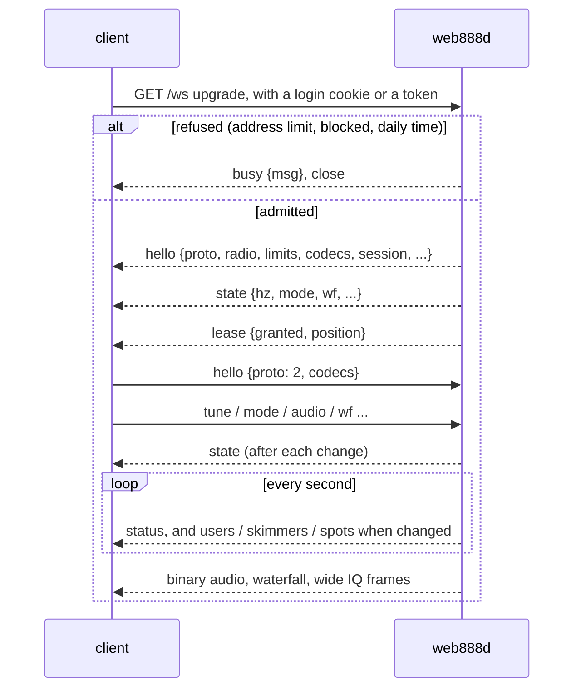

# web888d API for external applications

Status: **draft, being built** (2026-11-19). Sections 2-7 describe what
web888d does; §8 says which proposals are built (**Built**) and which
are not yet (**Proposed**). Protocol version 3 is served from server
0.17.0; version 2 clients are still served.

## 1. Why

Programs other than the web page can use the receiver today only
through compatibility protocols: Kiwi (`doc/m5-kiwi.md`: kiwirecorder,
wsprdaemon) and HPSDR Protocol 1 (`crates/hpsdr`). They work, but they
are other projects' designs, and nothing web888-specific fits in them:
the skimmers' spots, frequency labels, listening along with another
user, the queue for a receiver, the channelizer's wide IQ, propagation,
the overload and status figures.

The web page itself talks to web888d over a small WebSocket protocol
and a set of JSON endpoints. That protocol already has a TypeScript
and a Rust side checked against the same fixtures
(`crates/web/tests/proto/`), so the plan is not a new API but making
the existing one public:

* document it (this file), version it, and say which parts are stable;
* let programs authenticate without a browser login (tokens, §8);
* keep it honest with a reference client (§9) and the shared fixtures.

The page stays an ordinary client of the same protocol: anything it can
do, a program can do, except what the page does locally (§7).

## 2. Interfaces at a glance

| interface | where | for | stability (proposed) |
|---|---|---|---|
| Listener protocol | WebSocket `/ws` | tuning, audio, waterfall, wide IQ, users, spots, status | **stable** from v3 (§4-6) |
| Public JSON | `GET /api/...` | spots, labels, band plan, info, propagation, map, status | **stable** where marked (§7.1) |
| Admin JSON | `/api/admin/...` | config, sessions, logs, updates | documented, **unstable** (§7.2) |
| Metrics | `GET /metrics` | Prometheus text (`doc/metrics.md`) | metric names stable, additions any time |
| Kiwi | `/<ts>/SND`, `/<ts>/W/F`, `/status`, `/VER` | Kiwi clients | as Kiwi's (`doc/m5-kiwi.md`) |
| HPSDR P1 | UDP 1024 | SDR programs (up to 7 receivers, 48 kS/s) | as the protocol's |

HTTP and HTTPS share one port (a TLS handshake is told apart by its first
byte); behind a reverse proxy `[web] trusted_proxies` makes the limits
see the real client.

## 3. Conventions

* JSON in WebSocket text frames, binary data (audio, waterfall, IQ) in
  binary frames, **little endian**.
* Frequencies are **Hz** as JSON numbers (floats allowed), times are
  **UTC**: seconds since 1970 in JSON (`t`), milliseconds in binary
  headers. Levels are dB; `dBFS` is relative to the ADC's full scale.
* Frequencies are the receiver's own. With a converter
  (`radio.freq_offset_hz` in `hello`), the frequency on the air is the
  receiver's plus the offset; clients show that, and tune with the
  receiver's.
* Unknown fields in a message are ignored on both sides; a client must
  ignore unknown message `type`s and unknown binary `kind`s (§8 makes
  this the rule for additions).

## 4. Session

* The server speaks first: `hello`, the session's `state` (defaults:
  the receiver's default frequency and mode), then `lease`.
* The client's `hello` names the protocol it speaks (2 or 3); another
  number gets an `error` and close 4004.
* **Receivers are leased.** A session gets an RX channel when one is
  free; otherwise it waits in a queue (`lease {granted: false,
  position: n}`, 1 = next) and can meanwhile listen along with another
  user (`listen`). Audio flows only with a lease or while listening
  along. The waterfall doesn't need a lease.
* Every change the client asks for is answered with the whole new
  `state`, after the server has clamped it to what the receiver can do
  (frequency inside `rf_lo..rf_hi`, waterfall limits, rates). The client
  takes `state` as the truth, not its own request.
* **Limits** (`[limits]`, shown in `GET /api/info`): sessions per
  address, a session time limit, an idle limit (pings don't count as
  activity), daily minutes per address. A minute before a limit the
  server sends an `error` as a warning; at the limit it closes with a
  code from §6.3. Admin sessions have no time limits.

## 5. Messages (protocol 2)

### 5.1 Client to server

| type | fields | what it does |
|---|---|---|
| `hello` | `proto` (2), `codecs` (list, informative) | the protocol the client speaks |
| `tune` | `hz` | dial (the carrier); stops listening along |
| `mode` | `mode`, `lo`, `hi`, `pitch` (all but `mode` optional) | demodulator and passband relative to the dial (Hz; missing: the mode's defaults, which `state` then reports); `pitch`: CW tone |
| `audio` | any of: `agc`, `gain_db`, `agc_speed`, `agc_hang_ms`, `agc_decay_db_s`, `nb`, `nr`, `notch`, `squelch`, `squelch_db`, `audio_rate`, `codec` | audio chain; only the fields given change (below) |
| `wf` | `center_hz`, `decim`, `bins`, `fps`, `pack` | the waterfall view (§6.2) |
| `ping` | `t` | answered with `pong {t}` (round-trip time) |
| `share` | `on` | show my frequency to others and let them listen along (default on) |
| `listen` | `user` (a session id, or `null`) | listen along to another user's receiver, or stop |
| `spots` | `on` | the skimmers' spots: the last 30 min (at most 1000), then new ones |
| `name` | `name` | callsign or nickname others see (at most 8 characters; `""`: none) |
| `wide` | `on`, `hz` (default: the dial), `bits` (8 default, or 16) | wide IQ: the channelizer bin nearest `hz` (§6.4), when `hello.wide` |

Modes: `usb`, `lsb`, `cw`, `am`, `sam` (synchronous AM), `sal`, `sar`
(lower, upper sideband), `sas` (stereo: lower left, upper right), `iq`
(the channel's I/Q as stereo audio), `nbfm`.

`audio` fields:

| field | values |
|---|---|
| `agc` | on/off |
| `gain_db` | without AGC the fixed gain; with it the maximum gain |
| `agc_speed` | `fast`, `medium`, `slow`, `custom` |
| `agc_hang_ms`, `agc_decay_db_s` | with `custom`: hang 0-5000 ms, recovery 1-200 dB/s |
| `nb` | noise blanker threshold (impulse / mean level); 0: off |
| `nr` | noise reduction 0..1; 0: off |
| `notch` | automatic notch (steady carriers out) |
| `squelch`, `squelch_db` | squelch on/off and threshold (channel power, dBFS) |
| `audio_rate` | one of `hello.audio_rates` (12000 default, 24000 where the receiver allows); another value gives the default |
| `codec` | one of `hello.codecs`: `pcm16` (default), `mulaw`, `opus` |

### 5.2 Server to client

| type | fields | when |
|---|---|---|
| `hello` | `proto`, `server` (name and version), `codec`, `audio_rate`, `audio_rates`, `codecs`, `radio`, `limits`, `session`, `class`, `spots`, `wide` | first |
| `state` | `hz`, `mode`, `lo`, `hi`, `pitch`, `agc`, `gain_db`, `agc_speed`, `agc_hang_ms`, `agc_decay_db_s`, `nb`, `nr`, `notch`, `squelch`, `squelch_db`, `audio_rate`, `codec`, `wf`, `share`, `listen`, `name` | after connecting and every change, also one the server makes (listening along, a followed user's move) |
| `lease` | `granted`, `position` | after connecting and when it changes |
| `users` | `users`: `[{id, name?, hz?, mode?, rx}]` | when the list changes: others who share (`hz`, `mode` when they do; `rx`: they have a receiver) |
| `skimmers` | `skimmers`: `[{mode, dial, lo, hi, on}]` | when changed: the background decoders and the RF range each decodes (`on`: it has a channel) |
| `spots` | `spots`: `[{t, mode, band, dial, hz, snr, dt, msg, call?, grid?, drift?, dbm?, uncertain?}]` | after `spots {on: true}` and with each new batch, oldest first |
| `status` | `adc_overloads`, `clock_ppm`, `audio_drops`, `wf_drops`, `hw_rate_ok`, `cpu?`, `temp_c?`, `rf_atten_db?` | every second |
| `pong` | `t` | after `ping` |
| `busy` | `msg` | admission refused, before the close |
| `error` | `msg` | a bad message, a refused request, a limit's warning, a kick |

`hello` details:

* `radio`: `backend`, `variant` (`hf`, `vhf`), `adc_hz`, `rx_rate`,
  `rf_lo`, `rf_hi` (the tunable range), `wf_decim_min`, `wf_decim_max`,
  `freq_offset_hz` (absent: 0).
* `limits`: `bins_max`, `fps_max` for the waterfall.
* `session`: this session's id, as others see it in `users`.
* `class`: `web`, `guest` (a visitor on a receiver that leaves channels
  open without the listener password) or `admin`.
* `spots`, `wide`: the server runs skimmers / can give wide IQ.

`spots` fields: `t` slot start; `band` such as `"40m"` (`""` outside
the amateur bands); `dial` the skimmer's USB dial; `hz` the signal (its
lowest tone); `snr` dB in 2.5 kHz; `dt` s; `msg` the decoded text;
`call`, `grid` when the message has them; WSPR's `drift` (Hz) and
`dbm`; `uncertain`: possibly a false decode.

## 6. Binary frames

Each starts with `kind` (u8) and `flags` (u8). A client ignores kinds it
doesn't know.

### 6.1 Audio (`kind` 1)

| offset | type | |
|---|---|---|
| 0 | u8 | kind = 1 |
| 1 | u8 | flags: 1 overload (ADC), 2 gap (samples lost before), 4 stereo, 8 mu-law, 16 Opus |
| 2 | u16 | count: samples (both channels' when stereo) |
| 4 | u32 | seq |
| 8 | u32 | sample rate |
| 12 | f32 | channel power before AGC (dBFS): an S-meter |
| 16 | | payload |

Payload: PCM16 (`count` × i16), mu-law (`count` bytes, G.711), or one
Opus packet of 20 ms that decodes to `count` samples. Stereo is
interleaved, left first (modes `sas`, `iq`).

### 6.2 Waterfall line (`kind` 2)

| offset | type | |
|---|---|---|
| 0 | u8 | kind = 2 |
| 1 | u8 | flags: 1 overload, 2 first line of a new view, 4 stale (no new samples since the last line), 8 packed |
| 2 | u16 | bins |
| 4 | u32 | seq |
| 8 | f64 | centre of the first bin (Hz) |
| 16 | f64 | bin width (Hz) |
| 24 | f32 | `db0`: the level of value 0 (dBFS) |
| 28 | f32 | `db_step`: dB per value |
| 32 | f64 | UTC ms of the end of the line's interval |
| 40 | | `bins` × u8 levels, or packed |

A level is `db0 + v × db_step`. The levels are **absolute**: the page's
automatic levelling is done in the page, so a program can compare lines
across time (the antenna checks in `STATUS.md` were made this way).

The view (`wf`): `decim` is rounded up to a power of two within
`wf_decim_min..wf_decim_max`, and the span is `adc_hz / decim`;
`center_hz` is moved so the span stays inside the range; `bins` is a
power of two, 256-4096; `fps` 1-30. The applied view is in `state.wf`.

Packed lines (`pack: true` asked, flag 8; `crates/web/src/wfpack.rs`):
bits most significant first; per block of 64 bins, a 3-bit Rice
parameter k, then per bin the zig-zagged difference from the previous
bin (the first from 128; 0, -1, 1, -2 ... → 0, 1, 2, 3 ...) as
`u >> k` ones, a zero, and `u`'s low k bits; padded to a byte. A line
that wouldn't shrink is sent unpacked.

### 6.3 Close codes

| code | why |
|---|---|
| 1008 | kicked by the admin, or its API token revoked |
| 1013 | refused at admission (after `busy`) |
| 4001 | session time limit |
| 4002 | idle limit |
| 4003 | daily minutes used |
| 4004 | protocol version not supported |

Before the upgrade: HTTP 401 `login required` when a listener password
is set and the request has no login or token that may listen; HTTP 403
`origin not allowed` for a page from another site (§8.4).

### 6.4 Wide IQ (`kind` 3)

One channelizer bin: 60 kS/s complex, clean within ±21 kHz of its
centre. At most 4 streams on the receiver at a time (about 1 Mbit/s
each with 8-bit samples).

| offset | type | |
|---|---|---|
| 0 | u8 | kind = 3 |
| 1 | u8 | flags: 2 gap, 4 i16 samples (else i8) |
| 2 | u16 | count: complex samples (2048 a frame) |
| 4 | u32 | seq |
| 8 | u64 | the first sample's frame number (continuous across frames) |
| 16 | f64 | the bin's centre (Hz) |
| 24 | f32 | sample rate |
| 28 | f32 | scale: a sample is v × scale (1.0: a full-scale sine) |
| 32 | | `count` × (I, Q) |

Each frame is scaled by its own peak; use `scale` on every frame.

## 7. JSON endpoints

With a listener password set, the public ones need a login as `/ws`
does (unless the receiver leaves channels open). Errors are an HTTP
status with a short text or `{"error": "..."}`.

### 7.1 Public

| endpoint | returns | stable (proposed) |
|---|---|---|
| `GET /api/status` | `radio`, `sessions`, `adc_overloads`, `clock_ppm`, `hw_rate_ok`, `rx_frames`, `rx_lost_frames` | yes |
| `GET /api/spots?since=&mode=&band=` | `{spots: [...]}` as §5.2, oldest first; `since` UTC s (default: 30 min ago) | yes |
| `GET /api/markers?lo=&hi=&src=&region=` | frequency labels in `lo..hi` Hz; `src` any of `eibi,utility,amateur,own,dx` | yes |
| `GET /api/markers/info` | the label sources, region, EiBi season | yes |
| `GET /api/bandplan?region=` | a region's amateur band plan and other services' bands | yes |
| `GET /api/info` | name, location, station, description, privacy, the visitor rules | yes |
| `GET /api/info/photo`, `/api/info/licences` | the photo; the third-party licences | yes |
| `GET /api/propagation` | the VOACAP forecast and its inputs | experimental |
| `GET /api/map/info`, `/api/map/dx` | the receiver's locator; live DX spots with places | experimental |
| `GET /api/safe` | whether the receiver runs in safe mode | yes |
| `GET /api/auth` | the caller's role and which passwords are set | yes |
| `POST /api/login {password, admin}`, `POST /api/logout` | a login cookie (`web888d`, 12 h) | yes |

### 7.2 Admin

`/api/admin/...` with an admin login: `sessions` (list, kick, ban),
`leases`, `config` (get, validate, put; `schema`), `password`, `stats`,
`restart`, `atten`, `adc`, `skimmers`, `ovl` (the overload log), `logs`,
`markers` (own labels as CSV), `info/photo`, `backup`, `restore`,
`update` (status, check, install, reboot), `bootloader`, `safe/leave`.
They take JSON bodies only (the cookie is SameSite=Strict, so other
sites can't drive a logged-in browser).

These are the admin page's API. **Proposed:** documented here as they
are, but marked unstable: their shapes follow the admin page and may
change in any release. The few worth automating (sessions, stats, the
overload log, update status) can be promoted to stable on request.

## 8. Proposed for version 3

### 8.1 Versioning and compatibility (**built**, except the stable and experimental marks)

* `proto` is 3. The server accepts 2 and 3 for at least two releases
  after 3 ships, so the page and programs needn't change at once.
* `hello` (server) has `features`: names for what this server can do.
  Now: `ids`, `listen`, `share`, `name`, `wfpack`, `agc-custom`,
  `notch`, `squelch`, the codecs (`pcm16`, `mulaw`, `opus`),
  `audio-rates` (more than one), `spots` (skimmers run), `wide` (wide
  IQ). They replace the separate booleans over time. A client checks a
  feature before using it, not the version number.
* **Additions don't change the version**: new optional fields, new
  message types, new binary kinds and flags, new features. Clients
  must ignore what they don't know (§3). **Changes and removals do**,
  with the old form kept for two releases and listed in the release
  notes.
* Every message and field in §5-6 is **stable** unless marked
  **experimental** here; experimental ones can change in any release.
  Proposed experimental at the start: `wide`, `listen`, the
  `skimmers` list.
* A client `hello` with an unsupported `proto` gets `error` and close
  4004, instead of a session that goes on misunderstanding each other.

### 8.2 Request ids (**built**)

A client may put `id` (a number, or a string of at most 64 characters)
in any message; the server copies it into every message that answers
it (`state`, `error`, `pong`, `spots`, ...), also into the `error` for
a message it couldn't parse. Without it, a program
can't tell which of several requests an `error` was about.

### 8.3 Tokens (**built**)

A browser login is awkward for programs (a password in a script, a
cookie jar, 12 h expiry), so:

* The admin creates **API tokens**: a name, a scope, an optional
  expiry. The token (`w888_` and 64 hex digits, random 256 bit) is in
  the answer only; the config keeps its BLAKE2b hash (`[[auth.tokens]]`).
  * `GET /api/admin/tokens`: the list (no secrets);
  * `POST /api/admin/tokens {name, scope, expires_days?, unlimited?}`:
    a new one, `{name, scope, created, expires, unlimited, token}`;
  * `DELETE /api/admin/tokens/<name>`: revoked; its sessions end.
* Scopes: `read` (the public JSON, §7.1: spots, labels, info,
  propagation; no receiver), `listen` (also `/ws`, as a listener
  login), `admin` (also the admin API, as an admin login).
* Sent as `Authorization: Bearer <token>` on HTTP and on the WebSocket
  upgrade (programs can set the header; browsers can't, so the page
  keeps the cookie).
* A token session is an ordinary listener: it takes a lease from the
  same pool, counts against the limits and shows in the admin's session
  list with the token's name (`token`). A token made `unlimited` (a
  recorder) is spared the per-address, session, idle and daily limits,
  as an admin is.
* The admin page's Passwords tab has an **API tokens** card for all of
  this (`ui/tools/cdp/tokens.mjs` checks it).
* Kiwi and HPSDR stay as they are (Kiwi has its own password; HPSDR is
  for the local network).

### 8.4 Other changes

* **Built:** `Origin` check on `/ws`, as defence in depth:
  SameSite=Strict already keeps the cookie out of a WebSocket that
  another site opens, but an open receiver (no listener password)
  accepts such sessions today, which lets another site's page use the
  receiver's channels from its visitors' browsers. A page's Origin must
  name this receiver's host (the Host or X-Forwarded-Host name, any
  port) or be in `[web] allowed_origins` (`"*"`: any). Programs send no
  Origin and aren't affected. Kiwi's endpoints aren't checked.
* **Proposed:** `GET /api/openapi.json`: the JSON endpoints as an OpenAPI 3.1
  description, checked against the handlers in CI.
* **Built:** `GET /api/version`, without a login (for a client to say
  "this receiver is too old"): `{server, version, proto, proto_min,
  features}`.

### 8.5 Sample timestamps and the receiver's clock (**proposed**)

Programs and the page's own decoders want to know when a sample was
received at the antenna, not when it reached them: a time-code decoder
can then compare the station's time with the reception time, without
the network's and the buffers' delays. TDoA needs GPS (µs); for the
rest a clock disciplined by NTP or a time-code station is enough, and a
time-code station also serves air-gapped receivers.

**Two oscillators.** The ADC clock (122.88 MHz, the samples' rate and
every frequency the receiver shows) and the CPU's (the system clock,
which NTP or chrony steers). They are measured apart:

* the ADC clock against a reference: GPS PPS (the FPGA latches the
  sample counter at each pulse; `clock_ppm` today), or an LF time-code
  carrier measured in the samples themselves (their carriers come from
  atomic clocks; a minute of DCF77 at night gave the remote unit's
  ADC clock as +0.31 ppm, ±0.05 ppm per 10 s);
* the system clock against the ADC clock through the timebase below,
  hence against whatever disciplines that.

Both are logged with the board temperature (`temp_c`), so their
temperature dependence can be learned and used in holdover.

**The timebase.** Each hardware block has a continuous sample counter
(`first_frame`) and the system time it was read at. A smoothed fit of
counter against time (rate: the ADC clock as disciplined) gives every
sample a UTC time, without the read jitter, with:

* `source`: `gps`, `timecode` (which station), `ntp` (the system clock,
  disciplined), `holdover` (no reference now: the last rate and
  offset carried on), or `none` (never had one);
* `uncertainty` (s): from the source, and in holdover growing with the
  time since the last reference (the last rate's uncertainty times the
  elapsed time, plus a temperature term once learned).

**References come and go.** Time-code stations aren't heard around the
clock (LF sky wave at night and absorption by day, HF stations with
propagation; scheduled maintenance; local noise such as power-line
meter traffic, which buries DCF77 at the remote unit while it lasts),
and NTP needs a network. The receiver keeps time on its
own oscillators meanwhile:

* in order of preference: GPS, then a time-code station heard well
  enough (its quality measured, bursts of local noise skipped), then
  NTP; any of them can be absent;
* without any, `holdover`: the ADC rate learned last (with its
  temperature model) carries the timebase, and chrony's own holdover
  (its drift file) carries the system clock; the uncertainty grows
  until a reference returns, which then pulls the clock in by slewing,
  not by a step (a step only at start, when the error is large);
* a reference that disagrees with the others beyond its uncertainty is
  dropped (a wrong station, a bad decode).

**In the protocol** (feature `timestamps`):

* `audio {timestamps: true}`: audio frames carry flag 32 and 8 more
  header bytes, an f64 at offset 16: the UTC of the frame's first
  sample at the antenna (the receive chain's known delay subtracted);
  the payload follows at 24. Clients that don't ask see no change;
* a `timebase` message, when asked for and when it changes (source,
  uncertainty): `{source, uncertainty, adc_ppm, station?}`; for wide IQ
  also the mapping of its frame numbers to UTC (`offset`, `rate`);
* the waterfall's line times come from the same timebase.

**Time-code stations on the unit.** The time-code decoder
(`crates/timecode`) runs on the unit as well as in the page, watching
one channelizer bin (about 1 % of a core). A bin centred at 60 kHz
covers MSF (60 kHz), RBU (66.67 kHz) and DCF77 (77.5 kHz) at once;
which serve best (day, night, local noise) is to be measured with a
day-long recording first. From them: the ADC rate (the carrier's phase),
and the epoch (the second markers, ~1 ms; DCF77's phase code, perhaps
10-100 µs), corrected for the path from the station (from the
receiver's locator).

**The system clock: chrony.** The OS changes from systemd-timesyncd to
chrony: several NTP servers combined and cross-checked, a drift file
for holdover, a quick and safe start without a battery-backed clock,
and reference clocks. web888d hands chrony its time-code (and later
GPS-derived) time over chrony's socket reference-clock interface, as
gpsd does, so an air-gapped receiver's system clock follows the
station too.

**The page.** Its time-code panel compares each minute's time with the
antenna time of its first sample: what is left is the path from the
station and the receiver clock's error, a check on the clock; with the
browser's own clock it also shows how far the listener's computer is
off.

## 9. Reference client and adapters (proposed)

* **Reference client** (`tools/web888-client`, Python, no dependencies
  beyond `websockets`): connect, tune, record audio (WAV) and wide IQ
  (cs16, with SigMF metadata from the timestamps of §8.5), dump
  waterfall lines with absolute levels, follow spots as JSON lines. It is the test of this document: if it needs something
  the document doesn't say, the document is wrong. CI runs it against
  the simulator (`--backend sim`).
* **Hamlib `rigctld` adapter**: a small program (or a web888d option)
  that speaks rigctld's TCP protocol and drives one `/ws` session, so
  WSJT-X, fldigi and loggers can tune web888 and take its audio (with
  a virtual audio device). The most useful single addition for
  amateur software.
* **rtl_tcp / SpyServer**: already planned (`doc/design.md` §7,
  `doc/feature-gap.md`); they would sit on the same lease and wide IQ
  paths as §6.4.

## 10. What the API doesn't do

* **The page's own decoders** (CW, RTTY, PSK, JS8, HFDL, SSTV, NAVTEX,
  DSC, the time codes) run in the browser as WebAssembly
  (`doc/m8-browser-decoders.md`). A program gets the audio or wide IQ
  and decodes it itself; the server doesn't decode for clients. Running
  them on the unit for every client would cost the A9 more than it has
  (the skimmers already use about a core). The decoder crates are
  plain Rust and could be published as a library for clients.
* **Server-side skimmers** (FT8, FT4, WSPR) *are* available:
  `/api/spots` and `spots` over `/ws`.
* **Receiver settings** that affect every listener (attenuator, ADC,
  skimmer bands) stay admin-only.

## 11. Open questions

1. Token scopes: `read`, `listen`, `admin` are built; should `admin`
   be split (read-only status vs changes)?
2. Settled for now: an `unlimited` token skips the limits entirely; an
   admin-set maximum per token could come later.
3. The rigctld adapter: a separate program (any machine, many
   receivers) or built into web888d (one port per receiver, nothing to
   install)?
4. Reference client language: Python (most users of such tools) or Rust
   (shares `proto.rs`, one binary)?
5. How long to keep protocol 2: two releases, or until the page's
   cached copies are surely gone (the page revalidates on every load,
   so one release would do for the page itself)?
