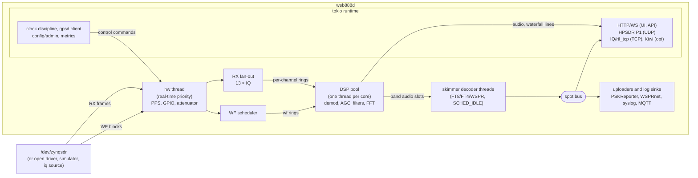

# web888d — design

Status: draft v0.2 (2026-10-16, progress updated 2026-10-24; milestones in §11). Project **web888-ng**, daemon `web888d`; licence **GPL-3.0-or-later** (2026-10-16; was MIT).

A new server for the Web-888 SDR (Zynq-7010, 2× Cortex-A9, LTC2208, open or
stock FPGA). It is **not** a port of the existing KiwiSDR-derived server: it
implements a chosen feature set on a new architecture.

---

## 1. Goals and scope

| capability | priority | notes |
|---|---|---|
| Hardware control + IQ channels | M1 | the base everything else uses |
| Standard client protocols | M1–M2 | HPSDR P1 first, then plain IQ/rtl_tcp |
| Own web UI | M2–M3 | multi-user waterfall + audio, new design |
| Digital decoders / skimmers | M4 | FT8/FT4/WSPR first; others as external processes |
| KiwiSDR wire protocol | M5 | ported from the upstream server (GPL-compatible, §12) |

Non-goals (for now): transmit, a plugin ABI for third-party native code,
running on anything other than Linux.

Design principles:

1. **Both cores, predictable latency.** Hardware I/O and DSP run on dedicated
   threads, and networking on an async runtime. Nothing in the sample path
   blocks on the network.
2. **Hardware behind a trait.** The same code runs on the stock driver, a
   future open driver, and a simulator, so most development and CI needs no
   board.
3. **Small, owned surface.** Features are added deliberately. Each protocol
   or decoder is an isolated module that can be compiled out.
4. **Measurable.** Every queue has a depth metric and every channel an
   overload/underrun counter.

## 2. Hardware model

Facts the daemon relies on (from `web888-ng-hw/fpga/doc/register-map.md` and
`web888-ng-hw/docs/stock-driver.md`):

| resource | count | properties |
|---|---|---|
| RX DDC | 13 | NCO 48-bit (f/fs·2^48), common decimation 256·R2 → 12/24/36/48 kS/s at 122.88 MHz; s32 I/Q, full scale 2^30; all channels share one output rate |
| WF DDC | 2 | own NCO, decimation 1..8192 (power of two), s16 I/Q; one-shot 8192-sample block or continuous ring |
| ADC | 1 | 16 bit, 122.88 MHz (HF) or 61.44..110.592 MHz (VHF/airband bitstream); dither, PGA, overflow |
| Front end | — | AD8370 attenuator, HF/VHF switch, 6 antenna-switch GPIOs, LED |
| Clock | — | Si5351 (I2C, ADC clock and clock out), 10 MHz ext ref select, GPS PPS counter |
| Time | — | PPS period FIFO; open FPGA also offers a 64-bit sample counter (STS 0x28) |

Constraints that shape the design:

* **One RX output rate for all 12–13 channels.** Per-user bandwidth is
  achieved in software (filtering/decimating further), so the hardware rate
  is a server-wide setting (default 24 kS/s: enough for 20 kHz AM/FM-N, cheap
  enough for 13 channels).
* **Only 2 hardware waterfalls** for potentially many users, so they need to be
  time-shared (§5.2).
* **The stock driver allows one opener** (`/dev/zynqsdr`, mutex_trylock). The
  daemon must be the single owner; it cannot run alongside the stock server.

## 3. Process architecture



* **hw thread** (1, real-time priority): owns the `Radio` backend; polls/reads
  RX and WF rings, PPS, applies queued control commands. Never allocates in the
  steady state.
* **dsp pool** (2 threads, one per core, `SCHED_FIFO` optional): processes
  *jobs* (an audio channel block, a waterfall frame) from a work queue; jobs
  are small (≈ 5–20 ms of samples) so both cores load-balance.
* **async runtime** (tokio, few threads, lower priority): all sockets,
  timers, child processes, config.
* **skimmers** (M4, `crates/skim`): each band is a job on the dsp pool that
  cuts its channel into USB audio slots. Decoder threads at `SCHED_IDLE`
  decode them with a deadline. Spots go out on a broadcast bus to the UI,
  the uploaders and the log sinks.
* Inter-thread data: lock-free SPSC/MPMC rings of fixed-size blocks
  (`rtrb`/`crossbeam`); control: bounded channels of commands. Slow
  consumers lose blocks (counted), they never stall producers.

## 4. Hardware abstraction

The trait as implemented (`crates/radio`):

```rust
pub trait Radio: Send {
    fn caps(&self) -> Caps;                        // channel counts, rates, ADC fs
    fn adc_hz(&self) -> f64;                       // rate used for NCO words
    fn set_adc_hz(&mut self, hz: f64);             // PPS-corrected estimate
    fn set_rx_rate(&mut self, r2: u16) -> Result<()>;
    fn rx_r2(&self) -> u16;
    fn tune_rx(&mut self, ch: usize, f_hz: f64) -> Result<()>;
    fn read_rx(&mut self, buf: &mut [Iq32]) -> Result<usize>; // whole frames, flat
    fn start_wf(&mut self, slot: usize, f_hz: f64, decim: u16, mode: WfMode) -> Result<()>;
    fn read_wf(&mut self, slot: usize, buf: &mut [Iq16]) -> Result<usize>;
    fn front_end(&mut self, fe: FrontEnd) -> Result<()>; // att, pga, dither, antenna, hf/vhf, ref
    fn pps(&mut self) -> Result<Option<u32>>;
    fn sample_counter(&mut self) -> Option<u64>;   // open FPGA only
    fn identity(&self) -> Identity;                // signature, DNA, build id
}
```

`read_rx` fills a flat buffer of `rx_channels`-sample frames (the ring
layout), because the channel count (12/13) is only known at run time.

Backends:

| backend | when | notes |
|---|---|---|
| `ZynqsdrIoctl` | M1 | talks to the **stock** kernel driver (ioctl ABI from `web888-ng-hw/docs/stock-driver.md`). Works with the stock and the open bitstream on unmodified firmware |
| `Uio` / open driver | later | own register access: timestamps, IRQs, extended status; needs the open driver or a DT overlay |
| `Sim` | M0 | synthetic signals (tones, noise) with the real channel model and timing; used by tests and CI |
| `Iq` | M1+ | real signals for development without a unit: wideband IQ from an SDR via SoapySDR (HackRF on an HF antenna) or a recording (cs8/cs16/cf32), channelized like the FPGA (crate `web888-iq`) |

Clock/si5351 handling lives beside the backend (I2C via `i2cdev`), because
it's needed before the bitstream is loaded and for GPS discipline.

## 5. Signal processing

### 5.1 Audio channel (per active receiver)

```
IQ @ Fs_hw (12..48 k) → CIC droop EQ + channel FIR (overlap-save FFT, per mode)
  → frequency shift (fine tune, passband offset) → demod
  → AGC → NB/NR (optional) → resample to client rate → encoder → transport
```

* Demodulators: AM, SAM (PLL), USB/LSB, CW (with BFO), NFM, IQ passthrough.
* Fine tuning in software between hardware NCO steps is unnecessary (48-bit
  NCO); the hardware NCO is retuned per user and the software shift only
  implements the passband offset (e.g. CW pitch).
* CIC droop: hardware has CIC N=5 at the last stage; compensation is
  computed from the decimation formula and folded into the channel FIR.
* f32 throughout, NEON-friendly loops; `rustfft`/`realfft` for FFT filters.
* Budget target: ≤ 3 % of one A9 core per audio channel at 24 kS/s.

### 5.2 Waterfall

* Each client waterfall = (centre, span, frame rate). Span determines WF
  decimation (power of two); centre determines NCO.
* **Scheduler** maps client requests onto the 2 hardware WF slots:
  * exclusive mode when ≤ 2 active waterfalls: continuous ring, steady frame
    rate;
  * time-shared mode otherwise: one-shot 8192-sample blocks, round-robin
    weighted by requested frame rate and span (narrow spans take longer to
    capture);
  * narrow spans inside an audio channel's band can be served from that
    channel's IQ (software FFT) without a hardware slot.
* Processing: window → 8192-pt FFT → |X|² → average (frame rate) → log →
  resample to client width (1024–4096 bins, max-hold per bin) → u8 dB.
* **Full-interval averaging (goal, improves on stock).** Each line should
  average the power of all samples in its frame interval (Welch: 50 %
  overlapping windowed FFTs, mean of |X|² before the log), not one
  snapshot. The stock server shows one short one-shot block per line
  (about 70 µs at zoom 0, a few ms zoomed). Impulsive noise, such as switch-mode
  supplies pulsing at 100 Hz, is then in some lines and not others. On a real
  unit (2026-10-21) that gave line-to-line steps of 0.9 dB at 3.5 MHz,
  1.8 dB at 29 MHz and 2.5 dB at 50 MHz, against 0.2 dB with the antenna
  disconnected. That is the horizontal streaking above about 24 MHz,
  where impulsive noise dominates the quieter bands, and the waterfall then
  disagrees with the audio, which integrates. With averaging, impulsive noise shows as
  a steady, raised floor, as it sounds.
  * Exclusive mode streams continuously (CFG 0x9E bit clear via
    `WF_READ_CONTINUES`), so the interval is fully covered up to the
    capture rate the HP port and CPU allow. At wide spans
    (decimation 1–4) take as many blocks as the budget allows, spread
    evenly over the interval rather than back to back.
  * Time-shared mode: spread several one-shot blocks over the interval
    when the scheduler has slack, rather than one block per line.
  * When resampling to the client width, average the power of the bins merged
    into one pixel (max-hold only as an optional "peak" view), or the
    noise floor gets speckled and biased upward.
  * Test: a `web888-pl` scene option for 100 Hz-gated impulsive noise; the
    per-line level spread (whole-line component) must stay
    within 0.3 dB of a stationary-noise run.
* Cost: an 8192-pt complex FFT is ≈ 1 ms on an A9 (NEON); 30 fps × 13
  users ≈ 40 % of one core — so frame rate is adaptive under load.

### 5.3 Wideband/IQ export

Channels can be leased raw to protocol clients (HPSDR, IQ streams) and
decoders: the DSP chain stops after the channel filter (or is bypassed).

## 6. Channel and session model

* **Session** = one connected client (web user, HPSDR client, decoder, …)
  with an identity, priority and limits.
* **Lease** = a session's claim on a hardware RX channel or a share of the
  waterfall scheduler. Leases have priority classes:
  `admin > skimmer (configured) > protocol client > web user`, idle
  timeouts, and optional per-IP/time limits.
* The **channel manager** grants, revokes and rebalances leases, and is the
  only place that retunes hardware NCOs.
* Skimmers (FT8 etc.) are configured leases that run in their UTC hours
  (e.g. "FT8 on 40 m 18–06 UTC"). As built (M4), they **yield to users**
  by default (`[limits] skimmers_yield`). A user who finds no free channel
  takes the newest skimmer's, and the skimmer waits for one to come free.

## 7. Network interfaces

| interface | transport | scope |
|---|---|---|
| Web UI | HTTPS/WSS (axum + tokio-tungstenite) | static SPA + JSON control + binary audio/waterfall frames |
| Admin/REST API | HTTPS | config, users, leases, metrics |
| HPSDR Protocol 1 | UDP 1024 | up to 7 receivers mapped onto RX leases; rates 48k (hardware 48k), lower rates by software decimation |
| IQ stream | TCP/UDP | raw cf32/ci16 per lease, simple framing with sample-counter timestamps |
| rtl_tcp | TCP | single channel, 8-bit IQ, for legacy apps |
| Kiwi protocol | WS | optional feature `kiwi` (§12) |
| Metrics | HTTP `/metrics` | Prometheus text |

Web UI (separate package `ui/`, TypeScript, GPL-3.0+): waterfall
(WebGL), spectrum, audio via AudioWorklet; codec choices (PCM16, IMA-ADPCM,
Opus) negotiated per client. The UI is a new design, not a reskin of an existing one.

## 8. Time and clock

* **ADC clock estimate** from PPS periods (median filter + PI loop);
  NCO words are always computed from the corrected fs, and retuned when the
  estimate moves by more than a threshold.
* Optional Si5351 trimming (GPSDO mode) is a separate, opt-in loop.
* **Timestamps**: with the open FPGA, every RX/WF block is tied to the
  sample counter. PPS edges give counter→UTC mapping, so IQ streams can carry
  GPS time (TDoA-capable). With the stock FPGA, timestamps are estimated from
  arrival time.
* gpsd client: the station locator from the fix (M4, `[station] gpsd`).
  Time from gpsd is not used yet.

## 9. Decoders

| decoder | library | integration | licence note |
|---|---|---|---|
| FT8/FT4 | own Rust (`crates/ftx`), from ft8_lib (MIT) and the QEX protocol paper | in-process threads | compatible; WSJT-X's Fortran (GPLv3-only) is used only to compare against |
| WSPR | Rust port of wsprd (`crates/wspr`) | in-process threads | wsprd's C is GPL-3.0-or-later |
| HFDL | dumphfdl | child process, IQ via pipe | GPL-3 compatible |
| ACARS / AIS | acarsdec / AIS decoder | child process | check per project |
| DRM AAC | FDK-AAC | **must** stay a separate process | Fraunhofer licence, not GPL-compatible |

Since web888d is GPL-3.0+, GPL decoders could be linked in. For C decoders,
separate programs over pipes or sockets are still the default, because a
crashing decoder then can't take the server down. The FT8/FT4/WSPR
decoders were written or ported in Rust instead (M4): memory-safe, bounded
by a deadline, at idle priority. FDK-AAC must never be linked. Results go
to a common spot bus: the UI, PSKReporter, WSPRnet, syslog and MQTT
(`doc/m4-skimmers.md`).

## 10. Configuration, security, operations

* TOML config, hot-reload for non-hardware settings; admin edits through
  the API write the same file.
* Auth: admin password (argon2), optional user passwords, per-IP limits,
  time limits; TLS via configured certs or behind a reverse proxy.
* Logs: stderr for now (`tracing` with a JSON option is still the plan).
  The skimmers' log (spots, band and upload events) can also go to syslog
  and MQTT; each sink chooses its events (M4). Metrics: queue depths,
  drops, ADC overload, CPU per thread, lease counts, skimmer slots and
  spots, uploads.
* Deployment: static `armv7-unknown-linux-musleabihf` binary + UI assets;
  OpenRC service on the stock Alpine image, replacing the stock server
  (single owner of `/dev/zynqsdr`). Bitstream loading + Si5351 init
  are done by web888d at start (same sequence as the stock system).

## 11. Milestones

| M | content | done when |
|---|---|---|
| M0 ✅ | workspace, `Radio` trait, `Sim` backend, DSP crate with tests, CI (x86 + armv7 cross build) | IQ from Sim through channel filter verified in tests (`crates/dsp/tests/dsp.rs`) |
| M1 🚧 | `ZynqsdrIoctl` backend ✅ (fake-driver tested), PPS loop ✅, HPSDR P1 ✅ (loopback tested); Si5351 plan/encoding ✅ (programming opt-in `--si5351-adc`, test unit only); open: test on a unit. IQ stream moved to M3 (needs leases next to HPSDR) | SDR++/SparkSDR receive 7 channels from a real unit |
| M2 ✅ | web UI MVP: 1 user, waterfall (exclusive), SSB/AM/CW audio (`doc/m2-web-ui.md`, v0.1.0) | usable in a browser |
| M3 ✅ | multi-user leases, WF scheduler, AGC/NB/NR, admin API, auth (`doc/m3-multi-user.md`, v0.2.0/v0.2.1); board benches wait for the test unit | 13 users + time-shared waterfalls |
| M4 🚧 | skimmers and spot reporting (`doc/m4-skimmers.md`): FT8/FT4/WSPR decoders ✅ (91–92 % / 89 % of jt9, 64/64 of wsprd on the corpus), runtime with yielding leases ✅, PSKReporter and WSPRnet uploads ✅ (accepted live from the HackRF), spots in the UI ✅, syslog/MQTT/gpsd ✅; open: A9 benches with all modes, docs, release | spots uploaded |
| M5 | Kiwi protocol (feature `kiwi`) ported from upstream | kiwirecorder/SuperSDR work |
| M6 | open-FPGA extras: timestamps, overflow/peak status, IRQ-driven I/O (open driver); proposed core: the channelizer bitstream (web888-ng-hw `docs/channelizer.md`) | GPS-timestamped IQ |

The order after M3 is being revisited against the stock firmware,
KiwiSDR and OpenWebRX+: `doc/feature-gap.md` (proposal).

## 12. Licensing and provenance

* web888d is **GPL-3.0-or-later**, as is the open FPGA (one licence for
  the project). The open kernel driver is GPL-2.0-or-later (kernel rule).
  It must not take code from the GPLv3 server, so it is written from the
  driver RE notes and the register map only.
* The upstream server (KiwiSDR-derived, RaspSDR/server) may be read and
  ported. Its files are mostly "GPL v2 or later" plus some "GPL v3 or
  later", all compatible with GPL-3.0+. Keep the original copyright and
  licence notices on anything copied or closely ported, and record the
  source path in the commit (`Ported-from: RaspSDR/server@<commit>:<path>`).
* Decoders (M4): FT8/FT4 are written from ft8_lib (MIT, notice kept) and
  the published protocol description; WSJT-X's Fortran is GPLv3 without
  "or later", so it is used only to compare behaviour, never translated.
  wsprd (C, GPL-3.0-or-later, including Phil Karn's Fano decoder) was
  ported directly, with its notices.
* **Do not copy**:
  * `pkgs/mongoose` (GPL-2.0-*only*: incompatible with GPLv3; we don't
    need it anyway).
  * FDK-AAC (`extensions/DRM/FDK-AAC`, Fraunhofer licence): out of
    process only.
  * Anything else whose header is missing or non-GPL-compatible: check
    first.
* **Clean-room exception: RaspSDR/server `zynq/`** (the Web-888 hardware
  layer: bitstream load, ioctl wrapper, LEDs, EEPROM). These files have no
  licence headers, and the top-level `_LICENSE` is vague ("mostly a mix of
  GPL v2.1/3 and MIT"). Implementers of web888d's hardware layer (`radio`
  crate, Zynq backend) **do not read `zynq/`**. They work only from
  `web888-ng-hw/docs/server-fpga-interface.md` (facts and interface, written
  as the boundary document), `web888-ng-hw/docs/stock-driver.md` and
  `web888-ng-hw/fpga/doc/register-map.md`. The hardware interface is mostly fixed by the
  driver ABI anyway. If RaspSDR later confirms a licence for `zynq/`, this
  exception can be dropped.

## 13. Open questions

1. Default hardware RX rate (24 k proposed) vs. per-deployment choice.
2. Audio codec default for the web UI (Opus quality vs. CPU on the A9).
3. Whether M1 should also expose SoapyRemote (broad client support, larger
   protocol) or only HPSDR P1 + IQ.
4. ~~Repository layout~~ decided: public `web888-ng-hw` (fpga, driver, tools, docs) and `web888-ng` (this repo; binary `web888d`).
5. Project name.
