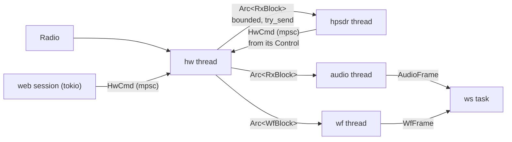
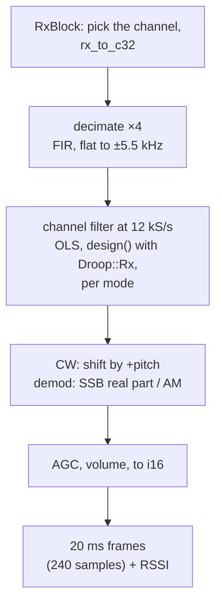

# M2 web UI: implementation plan

Status: **done** (2026-10-22, released in v0.1.0; decisions in §10). M3
then replaced this plan's per-session audio and waterfall threads with a
shared DSP worker pool, and protocol version 1 (§4) with version 2
(`m3-multi-user.md` §4, §8); what follows is the M2 design as built.
Scope from `design.md` §11 M2:
web UI MVP in a browser for one user, with an exclusive waterfall,
SSB/AM/CW audio and tuning. Design decisions already made in `design.md` §7
(axum, separate `ui/` package in TypeScript, JSON control plus binary
frames, WebGL waterfall, AudioWorklet, PCM16 first) are not reopened here.

Done when: on the workstation, `web888d serve --backend iq` with the HackRF
(or a recording) gives a usable receiver in Chrome and Firefox: the
waterfall pans and zooms, click to tune, USB/LSB/CW/AM audio without
dropouts, an S-meter, and HPSDR keeps working at the same time. The same
binary and UI run in the image in the emulator (sim/model signals).

---

## 1. Process and threads



The frames go over tokio mpsc channels with `try_send`; drops are
counted. The tokio runtime (2 workers) runs axum HTTP(S), the static
files, the `/ws` sessions and `/api/status`.

* **hw thread** (existing `hw.rs`, extended). It stays the only owner of
  the `Radio`. Changes:
  * The command enum is now `HwCmd { Tune{ch,hz}, Atten{db}, WfStart{slot,hz,decim},
    WfStop{slot} }`. HPSDR's `Control` is translated at its sender, so the
    hpsdr crate does not depend on web888d.
  * RX fan-out: a list of subscribers (`SyncSender<Arc<RxBlock>>`), each
    fed with `try_send`, so a slow consumer loses blocks (counted per
    subscriber) and never stalls the others. `RxBlock { first_frame: u64,
    nch, iq: Vec<Iq32>, overload }` moves to `web888-radio`. `first_frame`
    lets consumers see gaps. The hpsdr crate switches to `Arc<RxBlock>`
    (a small change, and it drops a per-block copy).
  * WF: while a slot is active (continuous mode), `read_wf` runs in the same
    loop. Samples go out as `Arc<WfBlock { slot, gen, contiguous, iq: Vec<Iq16> }>`.
    `gen` increments on every `WfStart`, so the wf thread drops stale
    samples after a retune. `contiguous = false` marks a gap: always at the
    block boundaries on the stock driver (back-to-back one-shots), and after
    a drop. FFTs never span a gap.
  * PPS retune covers the active WF slot too (restart with the new NCO word).
* **audio thread**: one per web session in M2 (a pool comes with M3
  leases). DSP in §3.1.
* **wf thread**: one, serving slot 0. DSP in §3.2.
* **tokio**: `multi_thread` with 2 workers, below the DSP threads in
  priority. No sample processing happens on the runtime.

Channel assignment for M2: the web user gets **the last RX channel**
(`--web-rx` default `rx_channels - 1`, i.e. 11 on HF). HPSDR keeps
`0..max_rx` with `max_rx = min(7, rx_channels - 1)`. The hardware rate
stays at 48 kS/s, which HPSDR needs. The 24 kS/s default question
(`design.md` §13.1) waits for M3, when leases make the rate a policy.

Single user: a second `/ws` connection gets `{"type":"busy"}` and is
closed with code 1013. Taking over from the existing user is an M3
feature (it needs auth).

## 2. Radio API additions

`Caps` gains:

* `rf_range: RangeInclusive<f64>`: tunable range. HF is 0..=61.44 MHz, VHF
  depends on the variant, and iq is `centre ± 0.45·rate`. The UI's full view
  is this range.
* `wf_decim_min: u16`: 1 on hardware and sim, the input divisor on iq (16 at
  7.68 MS/s). Today iq refuses smaller values, but nothing advertises the
  limit.

## 3. DSP (new code in `crates/dsp`, unit-tested there)

### 3.1 Audio chain (48 kS/s → 12 kS/s)



* The pre-decimation filter comes first: the sharp channel filter at 12 k
  needs about 4× fewer taps (and runs on 4× fewer samples) than at 48 k.
  `Droop::Rx` depends only on f, so `design()` works at 12 k unchanged.
* Modes and default passbands: USB 300..2700, LSB −2700..−300, CW ±250
  around the carrier with the pitch shift (default 700 Hz), AM ±5000. The
  UI sends `lo/hi`; edges are clamped to ±5 kHz (the pre-decimation filter
  is flat to 5.3 kHz, 160 taps). The channel filter's overlap-save FFT is
  sized for about 60 ms blocks (latency) rather than the default 150 ms.
  On a filter change, the new taps are designed on the audio thread
  (a few ms) and swapped in between blocks.
* Tuning: the hardware NCO is set to the dial frequency (the carrier). CW
  shifts in software only, as in `design.md` §5.1.
* **AGC** (an M2 minimum, refined in M3): a peak follower with
  1 ms attack, a hang time (SSB/CW 300 ms, AM 0) and then a 20 dB/s decay.
  It has a max gain and an "off + manual gain" setting. The RSSI is the
  channel power (dBFS) before AGC, averaged over the frame.
* Gaps: a jump in `first_frame` sets the next audio frame's gap flag
  (the UI counts these). The audio is not patched over.

### 3.2 Waterfall engine (Welch, as in `design.md` §5.2)

* Input: WF slot 0 continuous, `fs_wf = adc/decim`, span = `fs_wf`
  (complex).
* FFT size `N = max(1024, next_pow2(2·bins))`, ≤ 8192. Window:
  4-term Blackman-Harris. Hop: N/2.
* Per frame interval (1/fps): sum |X|² over all FFTs that fit, capped by a
  **budget** (FFTs per frame, `--wf-budget`, adaptive later). The engine
  streams with bounded memory: an FFT every `stride` samples, stride =
  max(N/2, samples in the previous line / budget), so above the budget the
  FFTs spread evenly over the interval instead of taking only the start.
* Narrow spans (fewer than N/2 new samples per interval): the hop shrinks
  so that each frame still has ≥ 1 FFT over the newest N samples (a
  sliding window). Frames never wait longer than 1/fps.
* Then: normalise (a full-scale sine reads 0 dBFS in any bin size), correct
  the WF CIC droop per bin (`wf_chain_mag`, precomputed per decim),
  fftshift, then merge to `bins` by **averaging power** (peak view is a
  UI option later), and quantise to u8 dB (§4.3).
* Test: the impulsive-noise criterion from `design.md` §5.2 (line-to-line
  spread within 0.3 dB of stationary noise). This is a dsp test with a
  synthetic 100 Hz-gated noise burst, not the `web888-pl` scene.
* Cost on the A9 (estimated here at 0.25 ms per 2048-point FFT) was
  measured in M3 at 0.41 ms, ~0.6 ms with window and accumulation: 20 fps
  × 30 FFTs is ~35 % of a core, so the default budget is 6 on 32-bit ARM
  (30 elsewhere). Samples between the budgeted FFTs are skipped
  unconverted. See `doc/m3-multi-user.md` §4.

## 4. WebSocket protocol (`/ws`, version 1)

Text frames carry JSON control (both directions); binary frames carry data
(server → client only). All binary fields are little endian. The Rust types
live in one module (`crates/web/src/proto.rs`) and the TypeScript mirror is
in `ui/src/proto.ts`. A round-trip test checks the JSON against fixtures in
`crates/web/tests/proto/` that both sides use.

### 4.1 Client → server

| type | fields | notes |
|---|---|---|
| `hello` | `proto: 1`, `codecs: ["pcm16"]` | first message |
| `tune` | `hz` | dial frequency; clamped to `rf_range` |
| `mode` | `mode: usb\|lsb\|cw\|am`, `lo?`, `hi?`, `pitch?` | passband relative to the dial |
| `audio` | `agc: {on, max_gain_db?}`, `gain_db?`, `mute?` | |
| `wf` | `center_hz`, `decim`, `bins`, `fps` | the server clamps and echoes the values it used |
| `ping` | `t` | the server answers `pong` (latency shown in the status bar) |

### 4.2 Server → client

| type | fields |
|---|---|
| `hello` | `proto`, `server` (version), `codec` (chosen), `audio_rate` (default), `audio_rates` (choosable), `radio: {backend, variant, adc_hz, rx_rate, rf_lo, rf_hi, wf_decim_min, wf_decim_max}`, `limits: {bins_max, fps_max}` |
| `state` | the full authoritative state after any change: `hz`, `mode`, `lo`, `hi`, `pitch`, `agc`, `gain_db`, `wf {center_hz, decim, bins, fps}` |
| `status` | 1 Hz: `adc_overloads`, `clock_ppm`, `audio_drops`, `wf_drops`, `hw_rate_ok` |
| `busy`, `error` | `msg` |

### 4.3 Binary frames

Audio (`kind = 1`), every 20 ms:

| off | type | field |
|---|---|---|
| 0 | u8 | kind = 1 |
| 1 | u8 | flags: bit0 ADC overload, bit1 gap before this frame |
| 2 | u16 | n samples |
| 4 | u32 | seq |
| 8 | u32 | sample rate |
| 12 | f32 | RSSI, dBFS |
| 16 | i16 × n | PCM16 mono |

Waterfall (`kind = 2`), one line:

| off | type | field |
|---|---|---|
| 0 | u8 | kind = 2 |
| 1 | u8 | flags: bit0 ADC overload, bit1 new `gen` (retune/zoom), bit2 stale (no new samples since the previous line; M3) |
| 2 | u16 | bins |
| 4 | u32 | seq |
| 8 | f64 | frequency of the first bin's centre (Hz) |
| 16 | f64 | bin width (Hz) |
| 24 | f32 | dB of value 0 (dBFS) |
| 28 | f32 | dB per step (160/255: −160..0 dBFS) |
| 32 | f64 | time, Unix ms (of the end of the interval) |
| 40 | u8 × bins | levels |

Every line carries its own frequency mapping, so the UI keeps history
aligned while panning and zooming (§5.2), and the UI colour range
(contrast) is applied client-side.

Bandwidth: audio 24 kB/s, WF 1024 bins × 20 fps ≈ 21 kB/s.

## 5. UI (`ui/`, TypeScript, GPL-3.0+)

### 5.1 Tooling

* `pnpm`: dev dependencies `typescript` and `esbuild`; the only runtime
  dependency is **Preact** (MIT, §10.2) for the controls (and, in M3, the
  admin/config pages). The waterfall, spectrum and worklet stay plain
  TypeScript. `pnpm build`
  runs `tsc --noEmit` and esbuild into `ui/dist/` (index.html, app.js,
  worklet.js, style.css; hashed names not needed). `pnpm dev` is esbuild
  watch.
* Tests: `node --test` on the pure modules (protocol parsing against the
  shared fixtures, frequency formatting/stepping, resampler).

### 5.2 Structure

```
ui/src/
  main.ts              boot, start overlay (AudioContext needs a click), layout
  proto.ts             message types, binary frame parsers
  net.ts               WebSocket, reconnect with backoff, ping
  state.ts             small observable store: radio, tuning, view
  view/waterfall.ts    WebGL2: R8 history texture (ring of lines × bins),
                       per-line (f0, df) in a float texture, colormap LUT,
                       contrast uniforms; scroll = ring offset
  view/spectrum.ts     Canvas 2D: latest line + slow average, peak hold
  view/scale.ts        frequency axis, passband overlay, tuning marker
  ctl/*.tsx are Preact components; view/ and audio/ are plain TS.
  ctl/freq.tsx         frequency display: per-digit wheel/keys, typed entry
  ctl/panel.tsx        mode, bandwidth, AGC/gain, volume/mute, zoom, contrast
  ctl/smeter.tsx       RSSI bar + dBFS readout, overload lamp
  audio/player.ts      AudioContext, worklet node, volume
  audio/worklet.ts     ring buffer + adaptive resampler 12k → context rate
```

Behaviour:

* The waterfall shader maps each screen pixel's frequency through **that
  line's** (f0, df). Old lines therefore stay in place when the view pans
  or zooms (they show blank outside their own span) instead of being
  smeared or cleared.
* Wheel on the waterfall: zoom around the cursor (power-of-two decimation
  steps, `wf_decim_min..max`). Drag: pan (WF NCO retune). Click: tune
  (snapped to 10 Hz, or 1 kHz in AM). Shift+wheel: tune step. Keyboard:
  arrows step, `u/l/c/a` select the mode.
* The URL hash keeps the frequency, mode and zoom (`#f=7074.0&m=usb&z=6`),
  so links reopen the same view.
* Audio: the worklet keeps a jitter buffer with a target of 150 ms. The
  resampling ratio is trimmed by a slow loop on the buffer fill (sound card
  vs. ADC clock drift). Underrun gives silence and a counter, never a
  replay. Linear interpolation first; a polyphase filter later if it is
  audible.
* Dark theme. The layout works down to a phone width, with the controls
  under the waterfall.

## 6. HTTP server (`crates/web`, crate `web888-web`)

* axum: `GET /` static from `--ui-dir` (default `/usr/share/web888d/ui`,
  `tower-http` ServeDir, gzip), `GET /ws`, `GET /api/status` (JSON, the
  same content as `status`).
* Listen: `--http 0.0.0.0:8073` (the stock server's port, so existing
  bookmarks and reverse proxies keep working). TLS on the same port
  (§10.1): the first bytes of a connection tell a TLS ClientHello from
  plain HTTP, so one port serves both. The certificate comes from
  `--tls-cert/--tls-key`, else a self-signed one generated on first start
  (rcgen, SANs: hostname, `localhost`, the interface addresses) and kept in
  `--state-dir` (default `/var/lib/web888d`). `--no-tls` serves plain only.
* Session: the tokio task holds the WS. Control goes from JSON to `HwCmd`
  (to the hw thread) or to a `SessionCmd` (to the audio and wf threads,
  over crossbeam channels). Data comes back through tokio mpsc.
* web888d wiring: `serve` starts hw, hpsdr, web (`--no-web` and
  `--no-hpsdr` to switch either off).
* Dependencies (all MIT/Apache, GPL-3.0-compatible): axum, tokio,
  tower-http, serde, serde_json, crossbeam-channel, tokio-rustls (ring
  provider; aws-lc-rs not needed) and rcgen.

## 7. Packaging

* web888d itself: new crates → regenerate `web888d-crates.inc` in the os
  recipe (as now).
* `ui/dist` into the image (question 3). Recommended: the server CI
  builds `web888d-ui-<version>.tar.gz` on `v*` tags (release + SHA256SUMS,
  like the hw bitstreams). A new os recipe `web888d-ui` fetches it by
  checksum into `/usr/share/web888d/ui`. Yocto then needs no Node, and dev
  images between tags can use a locally built tarball via
  `SRC_URI:append` in `local.conf`.

## 8. Development and test

* Workstation:
  `pnpm -C ui dev` plus `cargo run --release -p web888d --features soapy --
  serve --backend iq --iq soapy:driver=hackrf --iq-freq 8.6e6 ... --ui-dir ui/dist`,
  then `http://localhost:8073` (localhost counts as a secure context, so
  AudioWorklet works).
* The 3 s recording loops too often for UI work. Record about 60 s
  (≈ 920 MB cs8) with the same settings into `/data/iq`.
* Rust integration test (`crates/web/tests/session.rs`): sim backend
  (tone 7.0755 MHz at −40 dBFS) and a tokio-tungstenite client. Checks:
  `hello`, then tune 7.074 MHz USB → the audio's dominant tone is
  1500 ± 20 Hz, a WF line has its peak in the bin of 7.0755 MHz, and a
  second client gets `busy`. Runs in `cargo test --workspace`.
* Emulator: the image boots into web888d. Forward 8073 and check that the
  UI loads and the model's carriers appear in the waterfall (the model
  supports WF).

## 9. Steps (each ends in a commit)

| # | content | done when |
|---|---|---|
| 1 | hw loop: `HwCmd`, `RxBlock` fan-out, WF reading, `Caps` additions; hpsdr on `Arc<RxBlock>` | existing tests + p1probe against sim and iq unchanged |
| 2 | dsp: decimator, AGC, CW shift, Welch WF engine | unit tests incl. impulsive-noise criterion |
| 3 | `crates/web`: axum, proto, session, audio + wf threads; wiring in `serve` | session integration test passes |
| 4 | `ui/`: tooling, net/proto, waterfall + spectrum + scale, tuning | waterfall live from HackRF, pan/zoom/click |
| 5 | audio: worklet, modes/BW, AGC/gain, S-meter, URL state | listen to FT8/SSB/AM on 40 m with no dropouts over 10 min |
| 6 | TLS (per question 1), CI UI tarball, os recipe, README/design updates | image in the emulator serves the UI |

## 10. Decisions (reviewed 2026-10-22)

1. **TLS:** built-in, self-signed certificate for now (generated on first
   start, one browser warning per client); configured certificates and
   plain HTTP for a TLS-terminating proxy also work (§6).
2. **UI framework:** Preact, for the controls now and the admin/config
   pages in M3.
3. **Packaging:** CI tarball on `v*` tags + os recipe `web888d-ui` (§7).
4. **Port:** 8073 by default.

## 11. Listener tools (2026-11-17)

The receiver-parity items from `doc/feature-gap.md` §2.1-2.3 that live
in the page. All settings and memories are kept in the browser
(`localStorage`); nothing here costs the unit anything except the
custom AGC speed and the converter offset, which are server settings.

* **Palettes** (`ui/src/view/colormap.ts`): Default, Viridis, Heat,
  Phosphor, Grey, beside the waterfall's floor and top. Switching
  uploads a new 256-entry table to the shader; the history stays (it
  holds levels, not colours).
* **Peak hold** (`view/spectrum.ts`): the highest level each bin reached,
  drawn pink over the spectrum; ↺ clears it. It follows a pan like the
  average does, and starts afresh when the view's bin width changes.
* **Time marks** (`view/wfticks.ts`): UTC marks down the waterfall's left
  edge at round times (1 s to 6 h, chosen so marks stay ~40 px apart at
  the current line rate), from each line's server time.
* **PNG**: the spectrum and waterfall as they are, with the time marks
  and a caption (dial, mode, view, UTC, server), saved as
  `2026-11-17_091024_7066k_web888.png`.
* **Memories** (`ui/src/memories.ts`, the **Mem** button, key m): the
  dial with its mode and passband under an optional name; one per
  frequency and mode, sorted by frequency, at most 500. A click tunes
  (mode and passband in one request), ✕ forgets. Export/import as JSON
  (`{"web888_memories": 1, "memories": [...]}`); imports are checked
  entry by entry. On the phone: in More.
* **VFO A/B** (beside the dial, key v): A/B swaps the dial with the
  other VFO (frequency, mode, passband; the first swap copies), A=B
  copies the dial there.
* **Audio recording** (`ui/src/audiorec.ts`, **Rec**): the audio as it
  arrives (after the server's AGC, before the page's volume and
  pseudo-stereo) as a 16-bit WAV at the audio rate, 1 min to 1 h. *Skip
  silence* leaves out frames under -80 dBFS (squelch closed), so a long
  watch keeps only what was heard. A change of audio rate or to a
  stereo mode ends the file. Separate from **Rec IQ** (the bin's IQ,
  `doc/m8-browser-decoders.md` §7).
* **Key help** (key ?, or *keys* in the status bar): the keys and the
  mouse and touch gestures.
* **Custom AGC speed** (**C** beside F/M/S): the hang time (0-2 s on the
  slider, the protocol takes 0-5 s) and the decay (2-100 dB/s on a log
  slider, the protocol 1-200). Server: `agc_speed: "custom"` with
  `agc_hang_ms`, `agc_decay_db_s` in `audio` and `state`
  (`doc/m3-multi-user.md` §8). Kiwi clients keep their mapping of the
  decay time onto F/M/S. With the max gain (the Kiwi "threshold") this
  covers Kiwi's AGC controls but its slope.
* **Converter offset** (`[radio] freq_offset_hz`, a restart): every
  frequency the page shows is the receiver's own plus this (the dial, the
  scale, typed frequencies, lists, decoder panels, the title). The
  server sends it in `hello`'s `radio.freq_offset_hz` and adds it to the
  skimmers' spots, so PSKReporter, WSPRnet, MQTT, syslog and the map get
  frequencies on air; the page takes it off again to place spots on the
  scale. The URL's `#f=` stays the receiver's own. The frequency labels,
  the band ribbon and the phone's band picker are hidden while it is set
  (they are for frequencies on air). Kiwi and HPSDR clients see the
  receiver's own frequencies.

Checked with `ui/tools/cdp/listener.mjs` on the sim backend (every item
above; the offset with `freq_offset_hz = 116000000`: the dial and scale
at 144 MHz, 144300 typed tunes 28.3 MHz) and the phone layout
(`phone.mjs`).

## 12. The rest of receiver parity, access and the info page (2026-11-17)

* **IQ mode** (the **IQ** button, key i): the channel itself as stereo
  audio, I left and Q right, ±5 kHz around the dial (±10 kHz at
  24 kS/s). The protocol had the mode for Kiwi clients; the page now
  offers it. With the codec on Opus it comes as PCM (Opus and μ-law
  would bend I and Q apart; the button reads "Opus (PCM)"). **Rec** then
  saves an I/Q WAV (two channels) that SDR programs open. The
  pseudo-stereo is off in IQ.
* **Audio spectrum** (`ui/src/view/afspec.ts`, **AF** beside PNG): a side
  panel with the audio's spectrum (averaged) over its waterfall, in the
  waterfall's palette, the passband shaded; 512-point Hann blocks, half
  overlapping (~23 Hz a point, ~47 lines a second at 12 kS/s). Mono
  modes: 0 to half the rate; IQ: both sides of the dial. Lines are
  queued and drawn once an animation frame from a ring of pixel rows
  (drawing each line at once cost the page's thread so much that a fetch
  took 15 s in headless Chromium).
* **ADC dither and PGA** (admin Status card, beside the attenuator;
  `[radio] adc_dither`, `adc_pga`, applied at once through the hw
  thread's `HwCmd::Adc`; the GPIO word's bits 6 and 7, driven by every
  bitstream). PGA: 1.5 V full scale instead of 2.25 V, ~3.5 dB more level
  (and overloads that much sooner).
* **Access** (`[limits]`, apply at once):
  * `blocked`: addresses or networks refused (web and Kiwi); the admin
    Sessions page's **Ban** adds the session's address and ends its
    sessions. Admins still get in.
  * `daily_minutes`: listening time per address and UTC day; when used
    up, new sessions are refused and a running one ends with a minute's
    notice (close code 4003, no reconnect). Ended sessions count; admins
    and `trusted` addresses aren't limited.
  * `open_channels`: with a listener password, visitors without it may
    use this many receivers at once (a lease class `guest` below `web`
    with this quota: beyond it they queue); the page connects them
    without the form, shows *visitor: log in* in the status bar and
    **Log in** in the queue banner; a login replaces the session. Kiwi
    clients without a password get in as guests too (`chan_no_pwd`
    says how many). `/api/auth` adds `open_channels`.
* **Info page** (**Info** in the header, or the page with `#info`;
  `/api/info`, `crates/web/src/info.rs`): the name and location (`[kiwi]
  name`, `location`), the station's callsign, locator and antenna, the
  owner's `[info] description` and `contact`, a photo, and the limits a
  listener meets in sentences. The admin's **Info page** tab uploads or
  removes the photo (JPEG, PNG or WebP by their first bytes, at most
  3 MB, kept beside the configuration file as `info-photo.*`).
* A refusal now keeps the server's reason on the page (the "busy" message
  was replaced by the generic "The receiver is in use." when the
  connection closed).

Checked with `ui/tools/cdp/access.mjs` on the sim backend (IQ and its
WAV, the AF panel, the info page, the admin's ADC switch, photo and Ban;
`GUEST=1`: two visitors and one open receiver, the second queues, logs
in and gets a receiver), and the server tests (`blocked_addresses_and_the_daily_limit`,
`guests_get_the_open_receivers_and_the_info_page`,
`adc_ban_and_the_info_photo`).


## 13. HF propagation forecasts (2026-11-17)

**Prop** in the header (or the page with `#propagation`) opens a panel
with VOACAP forecasts from a few regions to this receiver
(`crates/prop`, `crates/web/src/prop.rs`, `ui/src/ctl/prop.tsx`).

* **The engine** is [hfcast](https://github.com/jonathanmcsweet/hfcast-engine),
  a Rust port of VOACAP checked value by value against the Fortran
  (Apache-2.0; we depend on our fork `jeskko/hfcast-engine`, pinned to
  a commit, with the coefficient maps compiled in; `NOTICE-hfcast.md`).
  We evaluated it on 2026-11-17: its own checks pass against a gfortran
  build of voacapl; of 3,000 random inputs 2,941 matched exactly, 46
  differed where the Fortran itself changes with its compiler flags,
  about 12 by one in the last digit, and one (a user-supplied electron
  density profile, which we never send) panicked. Each engine run is
  inside `catch_unwind`; a failure is that region's error.
* **What it computes**: per region, the month's median for each UTC
  hour: the MUF, and for each band the reliability (the share of days a
  signal gets through) for three kinds of signal, SSB (48 dB in 1 Hz),
  CW (27) and FT8 (13), and the median SNR. The transmitter is
  `power_w` (100 W) with isotropic antennas at both ends; the receiver's
  man-made noise is `noise_dbw` (-150 dBW at 3 MHz, rural). One engine
  run per region and mode: 7 regions take 3.8 s on the receiver, in the
  blocking pool, once when an input changes (the month, the sunspot
  number, the locator, the settings; with Truecast, the day).
* **Offline or online**: the smoothed sunspot number is `[propagation]
  ssn` if set; else NOAA SWPC's predicted solar cycle
  (`predicted-solar-cycle.json`, fetched daily when `fetch` is on and
  kept in `[web] state_dir` as `propagation-ssn.json`, so a receiver that
  loses its network keeps the last table); else the table built into
  hfcast (to 2030, held at its end after). The planetary K index is
  fetched every 30 minutes and shown; from Kp 5 the panel warns that the
  forecast is too optimistic (VOACAP knows only quiet days). With
  `fetch = false` the server makes no connections for this; the URLs can
  point at a local copy.
* **Engines**: `engine = "voacap"` (the month's median, default) or
  `"truecast"` (hfcast's day-conditioned form: the month's number plus
  its fitted correction for the day of the year; validated only by its
  author).
* **The panel**: *All regions, now*: regions by bands at the current
  UTC hour, the reliability in each cell (0-100) and the MUF; a region's
  name opens *the day*: bands by the 24 UTC hours, with the MUF row. The
  mode buttons switch SSB/CW/FT8. A band's name tunes to it. The
  receiver's location is `[station] locator` (gpsd's when set).
* `GET /api/propagation` (a login where `/ws` needs one): `enabled`,
  `problem` (why there is no forecast), `fetch_errors`, `kp`, and
  `forecast` (`ssn`, `ssn_source` {kind: config, noaa, builtin}, `modes`,
  `bands`, `paths` with `muf`, `fot`, `luf[mode]`, `rel[mode][band][hour]`,
  `snr[band][hour]`).

Checked with `ui/tools/cdp/prop.mjs` on the sim backend at desktop and
phone sizes, and on the unit.

## 14. Licences view, drop-downs, two fixes (2026-11-17)

* **Licences and credits** (a button at the foot of the info box):
  web888d's licence and the three source repositories; the code it was
  ported from or written against (Kiwi protocol, ft8_lib, wsprd and
  Phil Karn's Fano decoder, jtty-cuf, JS8Call, dumphfdl's station table,
  opus1/libopus, hfcast/VOACAP) with authors and licences; the data
  (VOACAP's coefficients and their CCIR origin, EiBi, Natural Earth, NOAA
  SWPC, Spothole, our own band plans); and every third-party library in
  the build. That list is `crates/web/src/third-party.json` (the Rust
  crates web888d builds with for the device, from `cargo metadata`, and
  the page's npm packages), written by `scripts/third-party.py` and
  served at `GET /api/info/licences`; CI fails when it is out of date
  (`scripts/third-party.py --check`, in the ui job).
* **Drop-downs** (`ui/src/ctl/drop.tsx`): the passband, the codec and the
  audio rate are one button each in the header (the current choice and
  ▾) instead of a row of buttons; the phone's More sheet keeps the
  buttons. `cdp/codec.mjs`, `cw.mjs` and `sigid.mjs` open the drop-downs.
* **Waterfall time marks flickered**: their interval was chosen afresh
  every frame from the measured line rate, and near a step (5 s or
  10 s, say) it flipped between the two, moving every mark. Now the
  interval holds while the marks on it stay 3/4 to 3 times the minimum
  spacing apart (`pickInterval`).
* **The AF spectrum on SSB was overdriven**: its range started from the
  quietest fifth of all points, which on SSB are mostly the filter's
  stopband, ~60 dB under the noise. Now from the points in the passband
  (`noiseFloor`).
