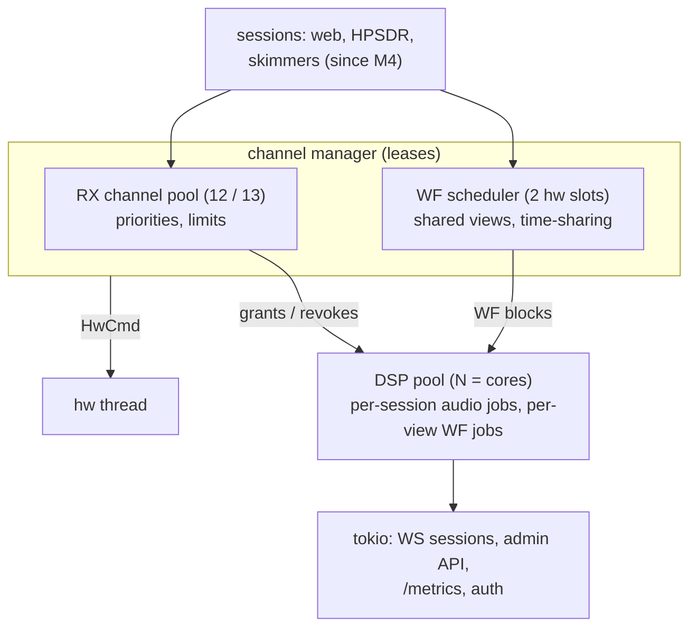

# M3 multi-user: implementation plan

Status: **done** (2026-10-23, released in v0.2.0 and v0.2.1; decisions
in §10), apart from step 9's load test with 12 users on a board: the
test unit was reordered, and so far web888d has run on the production
unit with a few web users and skimmers (2026-10-28). Scope from
`design.md` §11 M3:
multi-user leases, waterfall scheduler, AGC/NB/NR, admin API, auth.
Done when (design.md): 13 users at once with time-shared waterfalls.
Builds on M2 (`m2-web-ui.md`); decisions there stand.

Concretely, done when:

* 12 web users (HF: 12 RX channels) listen at the same time, each with
  their own waterfall view, and a 13th gets a waterfall-only session
  (§2.3). Checked with a load tool (§8) against the sim and iq backends,
  and on the test unit once it is here (CPU numbers only from the board).
* HPSDR clients and web users share the channels through the same lease
  manager.
* An admin logs in, sees sessions/leases/CPU/drops, kicks a user, edits
  the config (persisted, §6), and sets limits.

---

## 1. What changes, in one picture

M2 has one fixed channel and one exclusive WF slot for one user, two
threads per session. M3 replaces that with a **channel manager** that owns
all hardware assignments, a **WF scheduler**, and a **DSP pool**.

## 2. Channels and leases (`crates/core`, new)

### 2.1 Model

* **Session**: a client with an identity (web user, HPSDR client, later a
  decoder), a class and limits.
* **Lease**: a session's claim on one hardware RX channel. Classes, highest
  first: `admin > skimmer > protocol > web` (design.md §6). Skimmers
  arrive with M4; the class exists now.
* The **channel manager** is the only code that retunes RX NCOs. Sessions
  ask it (acquire, tune, release a lease); it answers with grants and
  revocations. It is a shared object behind a mutex (`web888_core::leases::
  Channels`; the policy itself, `Manager`, has no threads or I/O), so the
  HPSDR thread and the tokio sessions call it directly. It retunes through
  the hw thread with `HwCmd`, and each lease's state (waiting with a queue
  position, or granted a channel) goes to its holder through a
  `tokio::sync::watch`: polled by the HPSDR thread, awaited by sessions.
* HPSDR: receivers are leases, taken when a client starts streaming and
  released when it stops (or goes silent for 3 s). A receiver waiting for
  a channel sends zeros.

### 2.2 Policies (config, §6)

* Per-IP session limit (default 4), per-class channel quotas (e.g.
  HPSDR at most 7), optional time limit per web session (default none),
  idle timeout (no WS traffic / tab hidden: the UI says so; default
  none on LAN).
* Pre-emption: a higher class takes a channel from a lower one only if
  configured (`preempt = true`, default **off**); the evicted session
  falls back to waterfall-only (§2.3), not disconnected.

### 2.3 When the channels run out

The 13th web user gets a **waterfall-only session** with a "waiting for a
receiver" notice. It is queued and gets audio as soon as a channel frees
(FIFO within its class).

While waiting, it can **listen along** to another user's channel (any user
who hasn't opted out, §8): its own audio chain (mode, passband, AGC,
NB/NR, volume) runs on that channel's IQ, and the dial follows the
channel's owner. This costs DSP, no hardware channel. When its own
receiver is granted, the UI offers to switch. The opt-out is one per-user
setting covering both the frequency marker and listen-along (default:
shared); an admin can set the default and force it off per receiver.

### 2.4 Not in M3: sharing one hardware channel

Two users tuned within ±20 kHz of each other could share one 48 kS/s
channel (a software shift for the second). That multiplies capacity in
crowded bands, but it couples their tuning and complicates the manager.
It's left as a later optimisation, with the lease API shaped so it can be
added (a lease is "a channel + an offset").

## 3. Waterfall scheduler

Requests: one per session, (centre, decimation, bins, fps). Hardware: 2 WF
slots. Three mechanisms, applied in order:

1. **Shared views.** Sessions with the same (centre, decimation) share one
   stream and one FFT engine (`WfEngine` per view, lines fanned out to
   its sessions, re-binned per session's `bins`). The default full view is
   the common case, so most new users cost nothing extra.
2. **Narrow views from the user's own RX channel.** A view whose span is
   ≤ 40 kHz (inside the ±24 kHz of a 48 kS/s channel) and contains the
   user's audio channel is computed from that channel's IQ, so it needs no
   WF slot. This covers "zoomed in on the signal I'm listening to".
3. **Time-sharing.** With more distinct views than slots, the scheduler
   gives each view slot time in turn: one-shot 8192-sample blocks
   (exactly how the stock driver works anyway), weighted by requested fps
   and by span (narrow spans take longer to fill a block). With ≤ 2
   distinct views the slots stay continuous (exclusive mode, as in M2).
   The Welch engine already copes with sparse blocks: a line averages
   whatever blocks arrived in its interval, and repeats the newest when
   none did.

Fairness metric per view: achieved fps vs requested, shown in the admin
page. Unit tests run the scheduler against a fake clock and a fake radio
(block arrival times by span).

As built (step 4): `web888_core::wf::WfScheduler` groups the sessions'
hardware views and spreads them over the slots (greedy by load = fps x
block time); it hands the hw thread a plan per slot (`HwCmd::WfPlan`).
The hw thread streams a slot with one view continuously, or rotates its
views as one-shot blocks (`web888_hw::wf::Rotation`: each view due once
per line period, most overdue first, idle when none is due; lag bounded
to 1 s, shifting all views together so shares stay fair). Each hardware
view is a `ViewJob` on the DSP pool (one engine at its sessions' finest
bins and fastest rate; lines re-binned per session); a narrow view
(<= 40 kHz, within +-20 kHz of the dial) is drawn by the session's own
`AudioJob` from its channel. Waterfall frames carry a `stale` flag for
lines with no new samples; the load tool counts fresh lines as the
achieved rate. Under load a pool worker halves its waterfalls' FFT
budget per shedding level, then their rate.

## 4. DSP pool

Two threads per session (M2) is 26 threads for 13 users on 2 cores. M3
uses a pool of `N = cores` workers (2 on the Zynq), each pinned:

* jobs: "process this RxBlock for these audio sessions" (split across
  workers by session), and "push this WfBlock into this view's engine"
* per-session state (`AudioChain`) is owned by one worker at a time: a
  new session goes to the worker with the fewest jobs; jobs aren't
  migrated when others leave (the next ones fill the lighter worker)
* the hw thread feeds one RX subscription per worker, not one per session
  (`web888_core::pool`; a job is an `RxJob`, the session's audio is
  `AudioJob`)
* load shedding when behind: WF budget per view drops first, then fps;
  audio is never dropped deliberately (design.md §5.2, "frame rate is
  adaptive under load")

Budget on the A9, measured with `crates/dsp/examples/bench.rs` (armv7
musl build with `scripts/cross-armv7.sh OUT -p web888-dsp --example
bench`, one A9 core at nice 19 next to the stock server, 2026-10-22):

| | A9 | x86-64 workstation |
|---|---|---|
| audio chain, USB / AM, per session | 3.5 % of a core | 0.2 % |
| with NB + NR + squelch | 6 % | 0.3 % |
| WF view 1024 bins, 25 fps, 30 FFTs/line | 55 % | 0.5 % |
| WF view 1024 bins, 25 fps, 8 FFTs/line | 21 % (13 % skipping unused samples) | 0.25 % (0.17 %) |
| complex FFT 2048 (rustfft) | 410 µs | 3.5 µs |
| f32 FIR | 106 M MAC/s | 1290 M MAC/s |

12 audio sessions fit in under one A9 core. The waterfall doesn't at the
workstation default: rustfft has no NEON code on armv7 (and LLVM doesn't
vectorize f32 for NEON, so `-C target-cpu=cortex-a9` changes nothing,
measured), and every FFT costs ~0.6 ms with its window and accumulation.
On the A9 the WF budget (FFTs per line) has to start low: the default is
6 there (30 elsewhere). The engine skips samples between budgeted FFTs
without converting them (before, ~8 % of an A9 core per view at 1.92 MS/s
went to buffering samples no FFT used). The unit's own load (FT8 decoder
bursts every 15 s) makes single runs at nice 19 noisy; repeat them. The FFT is the kernel worth a NEON
implementation if the board still needs it.

## 5. DSP additions

* **AGC**: AM switches to a carrier-referenced AGC (gain from the
  carrier level, so modulation depth is kept); SSB/CW get a threshold
  ("AGC knee") and a fast/slow choice.
* **Noise blanker** (NB): impulse blanker on the channel's IQ before the
  channel filter (at 48 k, where pulses are still short): blank samples
  above k × the running mean magnitude, with a short taper.
* **Noise reduction** (NR): spectral subtraction on the audio (overlap-add
  STFT at 12 k, noise estimate by minimum statistics), strength 0..1.
* **Squelch** for AM/CW (RSSI threshold with hysteresis).
* Not M3: SAM, NFM, notch filters (candidates for M3.5 if wanted).

Each block gets unit tests in `crates/dsp` like the M2 ones (e.g. NB: a
-60 dBFS tone with 100 Hz impulses at +40 dB, tone SNR restored within
3 dB of the impulse-free case).

As built (step 6), chain order: NB (48 kS/s, 4-sample look-ahead, 4
after, threshold x running mean) -> decimate -> channel filter -> channel
power (S-meter, squelch) -> demod (AM with AGC: audio / carrier x target,
so 100 % modulation peaks at the target at any carrier level) -> NR
(256-point frames, 50 % sqrt-Hann, minimum statistics over ~1.4 s, gain
1 - 3 x strength x noise / power, floor -20 dB at full strength, smoothed)
-> SSB/CW AGC (fast 0.1 s / 40 dB/s, medium 0.3 s / 20 dB/s, slow 0.8 s /
10 dB/s) or fixed gain -> squelch (opens at the threshold, closes 3 dB
under it after 0.3 s, 5 ms fades). NR treats a carrier steady for longer
than its window as noise. Tests: NB tone SNR 15.9 dB clean, -5.8 dB
with impulses, 13.9 dB blanked; NR keyed tone within 1 dB, noise beside
it > 10 dB down; AM 50 % at -70 dBFS vs 25 % at -20 dBFS 6 dB apart.
Protocol: `state` and `audio` gain `agc_speed`, `nb` (threshold, 0 =
off), `nr` (0..1), `squelch`, `squelch_db`.

## 6. Configuration

* TOML file (`--config`, default `/etc/web888d/web888d.toml`); every CLI
  option has a config key, the CLI overrides the file.
* Hot reload of non-hardware settings (limits, auth, UI defaults) on
  change or on SIGHUP; hardware settings (backend, bitstream, rates) need
  a restart and say so.
* Admin edits go through the API, are validated, and are written
  atomically (temp file + rename) to the config path.
* **Where it persists on the device**: the root is read-only, and the
  config partition from `docs/os-base.md` doesn't exist yet. See question 5.

## 7. Auth and admin

* **Admin**: one admin account, password hashed with argon2 (crate
  `argon2`, MIT/Apache) in the config. Set at first start from the
  console (`web888d passwd`), or by the first login on a fresh unit if
  it's reachable only from the LAN (question 3).
* Login: `POST /api/login` → session cookie (HttpOnly, Secure, SameSite=
  Strict, random 256-bit id, server-side session store, 12 h expiry).
  Failed logins rate-limited per IP. All admin endpoints check it; the
  WebSocket gets the admin class when the cookie is present.
* **Listeners**: anonymous by default; an optional listener password
  (shared) for private receivers (question 2).
* **Admin API** (JSON, `/api/admin/...`): sessions (list, kick), leases,
  channel reservations, config (get, validate, put), stats (per-thread CPU
  from `/proc/self/task`, queue depths, drops, WF fairness), restart.
* **Metrics**: `GET /metrics` (Prometheus text), off by default.
* As built (step 7, `crates/web/src/{auth,admin}.rs`):
  * argon2id with the crate's default parameters (19 MiB, 2 passes);
    hashes are checked one at a time, so login attempts can't take the
    A9's cores. 5 failed logins per address per minute, then 429 with
    `Retry-After`; failures age out (a success doesn't clear them, or the
    listener password would reset the count between admin guesses).
  * The cookie gets `Secure` on TLS connections only (behind a plain-HTTP
    proxy it would never be sent back). A login records the hash its
    password matched and is valid only while that hash is still set, so
    a password change logs out its old logins (the admin who changed it
    gets a new cookie).
  * The admin password also opens a private receiver. HPSDR has no
    login (a LAN protocol).
  * Admin sessions get the Admin lease class and aren't counted against
    `per_ip`. Kick: an `error` message ("disconnected by the admin") and
    close code 1008.
  * Config over the API: JSON without `auth` (passwords only through
    `/api/admin/password`); `PUT` writes the file atomically and reloads
    it at once; the answer says whether it applied live or which sections
    need a restart, with the command-line options laid over the file as
    the server would. GET shows the file and the running config side by
    side (the difference is the command line).
  * `web888d passwd [--listener [--remove]]`; `/boot/web888d-admin`
    applied at start and deleted, also when a password is already set.
  * `/metrics` is `[web] metrics` (live): sessions, channels in use,
    lease queue, ADC overloads, RX frames, clock ppm, per-worker pool
    busy/jobs/shed/drops, CPU per thread name.
  * Restart exits with code 75; the unit's service has
    `Restart=on-failure`.
  * The receiver page asks for the listener password when one is set,
    and again if a reconnect is refused (password changed, login expired).
  * Not done: channel reservations (an admin holding a channel for a
    class); the lease manager has no notion of it yet.
* **Admin UI**: Preact pages in the same SPA under `#/admin` (status
  dashboard, sessions, config form generated from a schema the server
  serves, so the form follows the config). The receiver page stays as is.
* As built (step 8, `ui/src/admin/`): `#/admin/{status,sessions,config,
  passwords}`, linked from the receiver's status bar; switching between
  the receiver and the admin pages reloads the page (no WebSocket on the
  admin side). Status (every 2 s): RX rate, overloads, clock, the RX
  channels and who holds them, the queue, DSP workers (busy % from the
  busy-time deltas, shed level, drops), waterfall views, CPU per thread,
  restart. Sessions: the list with kick. Configuration: built from
  `GET /api/admin/schema` (schemars from the config structs; doc
  comments are the help texts, keys in file order): a select per enum,
  checkboxes, text/number inputs (empty = none for optional fields),
  JSON for lists and maps. Edits are validated by the server as you type
  ("applies at once" / "needs a restart: web"); values the running server
  has differently (command line, or waiting for a restart) are tagged.
  `tests/proto/schema.json` is the schema as served (checked by
  `tests/admin.rs`, read by the UI's tests).

## 8. Protocol v2 and the load tool

* `hello` gains the session id, class, and whether the session has a
  receiver (`audio: true/false`); a `lease` message reports grants and
  losses ("waiting for a receiver", "receiver granted").
* `users` message (1 Hz): other users' dial frequencies and modes (those
  who haven't opted out), drawn as markers on the frequency scale
  (Kiwi-style); a queued user picks one to listen along (§2.3).
* `share` (client): the user's opt-out; `listen` (client): listen along
  to a user id, or stop.
* New controls: `nb`, `nr`, `squelch`, `agc` threshold/speed.
* Versioning: the server accepts v1 clients until the UI ships v2 (same
  release), then v1 is dropped.
* As built (step 5), protocol 2 (v1 clients are refused with an
  error; the UI ships with the server):

  | message | dir | fields |
  |---|---|---|
  | `hello` | S→C | adds `session` (id), `class` (`"web"`) |
  | `state` | S→C | adds `share` (bool), `listen` (user id or null) |
  | `lease` | S→C | `granted` (bool), `position` (queue place, 1 = next; 0 if granted) |
  | `users` | S→C | `users`: [{`id`, `hz`, `mode`}], others who share and have a receiver; sent when it changes (checked 1/s) |
  | `skimmers` | S→C | `skimmers`: [{`mode` ("FT8", "FT4", "WSPR"), `dial`, `lo`, `hi` (the range it decodes, Hz), `on` (has a channel)}], the background decoders running; sent when it changes (checked 1/s). Added in M4, drawn as bars on the scale's bottom edge in their spots' colours |
  | `share` | C→S | `on` (bool) |
  | `listen` | C→S | `user` (id or null). Refused with an `error` if the session has a receiver of its own, or the user doesn't share / has none |
  | WF frame | S→C | flags bit2 `stale`: no new samples since the previous line |

  Listening along ends (an `error` saying why, then `state`) when the
  user followed stops sharing, loses their receiver or leaves; tuning
  ends it too. A granted receiver doesn't end it: the UI offers to
  switch. Clicking a marker listens along while waiting, else tunes to
  that user's frequency and mode.
* **Load tool** (`crates/web/examples/webload.rs`): opens N WebSocket
  sessions with given tunings/views, counts audio frames, gaps and WF
  fps per session, prints a table. Runs in CI against the sim (N = 13),
  and against the board later. No browser needed.

Sessions the server ends by its limits close with code 4001 (session
time limit) or 4002 (idle), after an `error` message with the reason; a
minute before, an `error` message warns. Clients shouldn't reconnect by
themselves after these (the UI offers a button).

## 9. Steps (each ends in a commit)

| # | content | done when |
|---|---|---|
| 1 | config file + CLI merge, hot reload | config round-trip tests; serve reads it |
| 2 | channel manager + leases; HPSDR on leases | unit tests (grant, release, quotas, queue, pre-emption off/on) |
| 3 | DSP pool; sessions use it (audio) | M2 integration test passes on the pool; 13-session sim test |
| 4 | WF scheduler: shared views, RX-channel views, time-sharing | scheduler tests with a fake clock; load tool shows fair fps |
| 5 | protocol v2, waterfall-only sessions, queue, listen-along, UI for lease state + user markers | load tool: 12 audio + 1 queued listening along, which gets its own receiver when one leaves; opted-out users can't be followed |
| 6 | DSP: carrier AGC, NB, NR, squelch; UI controls | dsp unit tests; listening check (user) |
| 7 | auth, admin API, `/metrics` | API tests incl. auth failures and rate limit |
| 8 | admin UI (Preact): dashboard, sessions, config form | browser check (muted) |
| 9 | armv7 benches, docs, release v0.2.0 (pre-release, with go-ahead) | benches run on the test unit when it's here |

## 10. Decisions (reviewed 2026-10-22)

1. **Channels exhausted**: queue with a waterfall-only session, and
   listen-along to other users' channels while waiting (§2.3; user's
   addition). Pre-emption by class stays an off-by-default option.
2. **Listener access**: anonymous by default, optional shared listener
   password; per-user accounts later.
3. **First admin password**: set from the console (`web888d passwd`) or
   `/boot/web888d-admin` read once at first boot and deleted; never a
   default password.
4. **Other users' frequencies** on the scale: yes, with a per-user
   opt-out (also covers listen-along) and an admin override per receiver.
5. **Config persistence**: the os image gets the small config partition
   (ext4, written only on save, `docs/os-base.md`) in step 1; config and
   the self-signed certificate live there.
6. **Hardware RX rate**: stays 48 kS/s; the 24 k idea is dropped unless
   board CPU numbers say otherwise.
