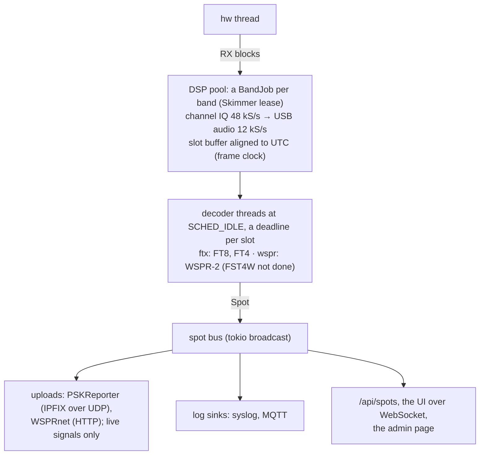

# M4 skimmers: implementation plan

Status: **done** (2026-10-28, v0.3.0; FST4W left for later). Decisions so far are in §9. Scope:
`design.md` §11 M4 and `feature-gap.md` §3 S: a decoder supervisor, FT8/FT4,
WSPR and FST4W autoruns, and spot reporting.
Done when (design.md): spots uploaded.

Concretely, done when:

* Autoruns from the config decode FT8/FT4 every slot and WSPR every
  2 minutes on the bands configured, on Skimmer leases. They yield to
  users when the channels run out and resume afterwards (stock bug #55).
* Spots go to PSKReporter, WSPRnet and MQTT, and appear in the UI and on
  the admin page.
* On the same audio, the FT8 decoder finds at least 90 % of what the
  WSJT-X `jt9` finds (target; §3.3 has the measurement), with no more
  than 1 % false decodes.
* Only spots from a **live** source are uploaded. The iq backend on a
  recording, the sim backend and WAV corpora never upload (§6.3).

---

## 1. Picture



## 2. Decoders, in process

Both decoders are Rust crates with no C dependencies. They run in their
own threads, so a slow decode can't stall the DSP pool, and Rust safety
covers what the child-process design (`design.md` §9) was for. Child
processes stay the plan for HFDL and DRM (milestone D).

### 2.1 `crates/ftx`: FT8, FT4 (FST4W planned)

* Base: a Rust port of ft8_lib (MIT, Kārlis Goba; RaspSDR's fork with OSD,
  subtraction and FST4/FST4W, `upstream/server/extensions/FT8/ft8_lib`).
  MIT notices are kept in the ported files.
* Shared parts: CRC-14, LDPC (174,91) belief propagation and OSD, 77-bit
  message pack/unpack with the callsign hash table, the encoder (for
  tests and subtraction).
* The demodulator front end is where the stock decoder loses (about 75 %
  of WSJT-X's decodes, from the fork's own README). Improvements follow
  the published algorithm (Franke, Somerville, Taylor, "The FT4 and FT8
  Communication Protocols", QEX 2020): per-candidate downsampling and
  fine sync, soft metrics over 1-3 symbols, time-domain subtraction, and
  multiple passes. Each step is measured against `jt9` (§3.3).
* **Licence note.** WSJT-X's Fortran is GPLv3 without "or later", and
  this project is GPL-3.0-or-later. So the FT8/FT4 code is written from
  ft8_lib and the paper; WSJT-X is only used to compare behaviour, not
  translated. wsprd's C is GPL-3.0-or-later and is ported directly (§2.2).

### 2.2 `crates/wspr`: WSPR-2

* A port of WSJT-X's `lib/wsprd` (C, GPL-3.0-or-later; Franke/Taylor,
  Karn's Fano decoder, Jenkins' nhash). rustfft replaces FFTW.
* Checked against the local `wsprd` on the same WAVs.
* FST4W-120 (and longer periods) are to come from `ftx`, on the same
  2-minute schedule (not done yet, §8).

### 2.3 Load

The stock server runs 11 FT8 channels on the Zynq's two cores with
ft8_lib. Our decoder does more work per candidate, so it gets a budget:

* a per-slot deadline (FT8 decodes after 13 s of signal; results must be
  in before the next slot ends), and passes that stop at the deadline
* decoder threads at `SCHED_IDLE` / nice 19, at most `cores - 1`
* CPU per decoder and per band on the admin page and in `/metrics`

The board numbers come when the test unit is here; benches run on the
production unit's A9 meanwhile (nice 19, as in M3; the stock server keeps
it busy, so these are upper bounds).

* 2026-10-23, first decoder: ~20 s of CPU per busy 40 m slot (desktop
  0.56 s). After the work in §3.3: **4.9 s** (desktop 0.14 s, ~35x).
  NEON auto-vectorisation (`+neon`) changes nothing.
* Cutting candidates or passes costs sensitivity quickly (passes 3 -> 2:
  -1.8 points for -18 % time), so instead each band gets a time budget
  per slot (`Decoder::decode_until`): strongest candidates first, later
  passes only if time is left. On the desktop 0.1 s keeps 88.5 % of
  jt9, 0.2 s the full 91.3 % (A9: roughly 3.5 s and 7 s). The skimmer
  divides the idle CPU between the bands.

## 3. Test corpus and scoring

### 3.1 Recordings

HackRF on the HF antenna (kept outside the repo). The first one is
`2026-10-23_8600k_4000k_40m30m_12min.cs8` (4 MS/s around 8.6 MHz, 12 min,
evening): FT8 and FT4 on 40 m and 30 m, plus WSPR. Its start time
(UTC, from the host clock) is in a `.start` file next to it.

### 3.2 Tool

`ftx` example `slotcut`: cuts USB audio at a dial frequency from an IQ
recording into 12 kHz WAVs, one per UTC slot, named like WSJT-X does
(`YYMMDD_HHMMSS.wav`). The same code path (channel → USB 12 k → slot)
is used by the skimmer job, so the corpus tests the production chain.

### 3.3 Score

`jt9 -8` (and `-5` for FT4, `wsprd` for WSPR) on each WAV is the
reference. A test compares the message sets:

* found = in both
* missed = only in jt9
* extra = only ours. Extras are listed, and checked by hand at first:
  they may be real decodes that jt9 missed, or false decodes.

The scores go in this doc at each improvement step.

| date | change | 40 m (1600 jt9 decodes) | 30 m (1267) | desktop s/slot |
|---|---|---|---|---|
| 2026-10-23 | first decoder (30 slots of 40 m, tuning set) | 77.7 % | – | 0.56 |
| 2026-10-23 | subtracted positions retried, LLR scale 5.5, sub-sample timing, OSD order 2 (60) with a plausibility filter | 86.8 %, 30 extra | 90.1 %, 12 extra | 0.7 |
| 2026-10-23 | OSD by CRC syndromes (orders 2 and 3 over all 91 bits), acceptance by distance ratio to the runner-up; subtraction in the frequency domain | 91.3 %, 54 extra | 92.3 %, 17 extra | 0.25 |
| 2026-10-29 | for the A9's time: soft bits from squared magnitudes and shared partial sums, the fine time search by a sliding DFT, the frequency step as a rotation and the sub-sample step as an 8-tap fractional delay (one inverse FFT per candidate, not three), min-sum BP (0.8) with WSJT-X's early stop | 91.1 %, 56 extra (FT4 unchanged: 89.3 %) | – | 0.10; A9 3.4 s/slot (5.0 before) |
| 2026-11-12 | sync symbol gates: a candidate needs 5 of the 21 Costas symbols on top at the coarse time peak (before the fine sync) and 8 after it (before: 7, after it only) | 91.1 %, 56 extra | 92.4 %, 15 extra | 0.078 (40 m), 0.063 (30 m): -26 %, -31 % |
| 2026-11-12 | for the A9's time again: the spectrogram from the band below 3.2 kHz at 3200 S/s (1024-point FFTs, no audio rebuilt between passes); a candidate needs 6 of the 21 Costas symbols on top in the spectrogram before it is downsampled | 91.1 %, 56 extra | 92.6 %, 15 extra | 0.063 (40 m), 0.048 (30 m); A9 2.3 s/slot (3.5 before) |

**Sync symbol gates (2026-11-12).** Of the candidates on a busy band
95 % never decode, and they took two thirds of the time: 80 % failed
the hard sync check only after the whole fine sync, and those that
passed it without decoding (BP and OSD three times each) took 39 %.
No decode of the first set has fewer than 5 Costas symbols at the
coarse peak, and 3 of 2700 have exactly 7 after the fine sync. FT4's
gate was 5 of 16, close to what chance gives with four tones (4); it
is now 7 at the coarse peak and 8 after. `Config::sync_symbols_coarse`
and `sync_symbols` (`FTX_SET` in the examples).

| set | mode | before | after | time |
|---|---|---|---|---|
| first, 40 m | FT8 | 1458 of 1600 | 1458 | -26 % |
| first, 30 m | FT8 | 1171 of 1267 | 1171 | -31 % |
| second (71 slots) | FT8 | 1626 of 1842 (88.3 %) | 1622 (88.1 %) | -26 % |
| first, 40 m | FT4 | 268 of 300 | 268 | -45 % |
| second (142 slots) | FT4 | 468 of 488 (95.9 %) | 468 | -58 % |

The four FT8 decodes lost on the second set are the price of the gate
at 8 (the coarse gate alone loses none there, for -14 %).

**Second set (2026-11-12).** `corpus/short-captures`: FT8 and FT4 on
160-10 m from 15 short captures (1-7 slots each; day, evening and
night; quiet bands too), with `cut.sh`, `ref.sh` (jt9 per WAV) and
`score.sh` beside the WAVs. It wasn't used for tuning. FT8 scores lower
there than on the first set, lowest on 20 m by day (82 % of 336): open.

OSD at that depth meets about 8 chance CRC-valid codewords per call. A
real decode is much closer to the received bits than the runner-up (median
ratio 0.54); a false one is just the best of the chance ones (median
0.93). The ratio limit is 0.65, or 0.75 when a callsign in the message has
been heard before.

The extras are now almost all real traffic (QSO partners seen in other
slots); jt9's AP decodes (28 and 25 of the misses) need a priori
information we don't use yet. 30 m wasn't used for tuning. A small labelled
corpus (a few WAVs and the expected messages) goes into the repo for CI.
The rest stays in /data.

## 4. Skimmer runtime (`crates/skim`)

* Config `[[skimmer]]` entries: `mode` (ft8, ft4, wspr, fst4w), `dial`
  (Hz), optional `hours` (UTC ranges, e.g. `"18-06"`), `enabled`. Band
  presets name the usual dials (`ft8 = ["40m", "30m", "20m"]`).
* A band = one Skimmer lease + one `SkimJob` on the DSP pool. The job
  mixes the channel down to USB audio at 12 kS/s and fills slot buffers.
  Slot times come from the frame clock (PPS-disciplined on the board,
  wall clock on the iq backend).
* One RX channel (48 kS/s, ±24 kHz) can carry several modes at nearby
  dials, e.g. FT8 7.074 + WSPR 7.0386 is too far, but FT4 10.140 + FT8
  10.136 fits. The supervisor packs dials onto channels when they fit.
* **Yielding.** Skimmer leases yield to users. When a web or protocol
  request finds no free channel, it takes the newest skimmer channel
  (regardless of `preempt`), and the skimmer waits again. It gets a
  channel back when one is free. The class order for everything else
  is unchanged. A per-skimmer `keep = true` marks one that never yields.
* A restart counter, a last-decode time and decodes per slot for each
  band; a band that hasn't produced a slot in 5 minutes is restarted and
  logged.

**Load shedding (2026-10-30).** The decoder threads run at
`SCHED_IDLE`, so listeners always come first; with many of them the
decoders get too little time and every band decodes poorly (on the unit
with 16 clients on 240 kHz views: 20-104 decodes a slot instead of
60-130, some slots with none). `skim::shed` makes that tidier: a
running pressure (each slot decoded cut short, or dropped, counts 1,
others 0; weight 0.2) above 0.5 sheds the band with the fewest decodes
a minute recently (its slots aren't decoded; its channel keeps running),
one at a time at least 30 s apart, never the last. When the pressure has
stayed below 0.1 for 2 minutes the last band shed resumes, then the next
after another 2 minutes; a band shed again within 5 minutes of a resume
doubles that hold (up to 30 minutes). Events `shed BAND`/`resume BAND`;
metrics `skim_shed`, `skim_slots_shed_total`, `skim_slots_cut_total`. On the unit (a5f872d, 16 clients on
240 kHz views, 3 minutes) it shed 21, 24.9, 28, 18.1 and 14 MHz in that
order, the bands with next to no decodes at night.

## 5. Spots

* `Spot { time, mode, dial_hz, freq_hz, snr_db, dt_s, drift (WSPR),
  message, call, grid, power (WSPR), band }` on a tokio broadcast bus.
* `/api/spots?since=&mode=&band=` (recent spots, ring of ~10k in RAM),
  and protocol 2 pushes new spots to UIs that ask.
* UI: a spot list panel (filter by band and mode, click to tune), and
  markers on the scale for the visible band. The map comes later
  (milestone M).
* Admin: per-band status (lease, last decode, decodes per slot, CPU),
  uploader state (queued, sent, last error).

## 6. Reporting

### 6.1 PSKReporter

* IPFIX over UDP to `report.pskreporter.info:4739`. Receiver record
  (callsign, locator, decoder software "web888-ng x.y"), and sender
  records (call, frequency, SNR, mode, locator when known, time).
* Batches every 5 minutes, with a random offset. A call+band+mode pair
  is sent at most once per 5 minutes. This follows their developer page.
* Tested against a local UDP listener that parses our IPFIX.

### 6.2 WSPRnet

* HTTP POST of each decode (the wsprd/Kiwi form fields), with a retry
  queue.

### 6.3 Live only

Each backend says whether it is live: `zynqsdr` and the iq backend on
SoapySDR are; the iq backend on a file, the sim and WAV inputs aren't.
The uploaders drop spots from a non-live source, and the reason shows on
the admin page. A config switch can't override this. Uploads also need a
callsign and a locator in `[station]`, and `upload = true` per service.
The development station uploads with a callsign of its own, set in its
local config (never a default in the repo).

### 6.4 MQTT

`[mqtt] server` (`host[:port]`, 1883), with an optional `username`,
`password` and `client_id` (default `web888-<host name>`). It is an
MQTT 3.1.1 publisher at QoS 0 over plain TCP, as the stock firmware's,
and it reconnects. Topics start with `topic` (default
`web888/<host name>`):
* `<topic>/spot/<MODE>`: JSON with the web protocol's spot fields, plus
  the stock `timestamp` and `server`, plus `live`.
* `<topic>/band` and `<topic>/upload`: JSON events with `source`,
  `level` and `text`.
* `<topic>/status`: `online`, retained, and `offline` as the last will.

Later: temperature, users.

### 6.4.1 What goes where

The user asked for this (2026-10-24): each sink chooses its events.
`events` takes any of `spot`, `band` (bands starting and stopping, and
their problems) and `upload` (uploader results and errors); the default
is all three. `modes` limits spots to those modes; empty means all. The
setting is per sink, so a kind can go to syslog, MQTT, both or neither,
e.g. spots to MQTT and band and upload events to syslog:

```toml
[syslog]
server = "logs.example.net"
events = ["band", "upload"]

[mqtt]
server = "broker.example.net"
events = ["spot", "band"]
modes = ["ft8", "wspr"]
```

### 6.5 Station position

`[station] locator`, or gpsd: `[station] gpsd = "127.0.0.1"` (port
2947). The client sends `?WATCH` for JSON and takes the 6-character
locator of each 2D or 3D fix (TPV). A change is taken once the new
locator has held for 5 reports, so a position on a subsquare's edge
doesn't flap. The first locator is taken at once. Without a fix the last
locator stays, and until there is one the configured locator is used.
The uploaders use this locator. Changes and connection problems are
`band` events (source `gpsd`). The admin card shows the server, fix and
locator.

### 6.6 Syslog

The user asked for this (2026-10-24). `[syslog] server` (`host[:port]`)
sends the skimmers' log to a syslog receiver. The log is the band start
and stop events, the uploaders' results and errors, and each spot,
chosen with `events` and `modes` (§6.4.1). It uses RFC 5424 (default) or RFC 3164,
over UDP (default) or TCP with RFC 6587 octet counting, and reconnects.
`facility` defaults to local0 and `hostname` to the system's. MSGID is
the source (`skim`, `pskreporter`, `wsprnet`, `spot`). Severities:
spots and counts are info, starts notice, failures warning. Messages
that can't go are dropped. It applies live.

## 7. Steps (each ends in a commit)

| # | content | done when |
|---|---|---|
| 1 | `ftx` common: CRC, LDPC BP + OSD, message pack/unpack + hash table, encoder | round-trip tests on WSJT-X message examples; encoder matches `ft8code` tones |
| 2 | FT8 decoder (ft8_lib front end), `slotcut` tool, scoring against jt9 | baseline score on the corpus in §3.3 |
| 3 | FT8 front-end improvements, one at a time, with scores | ≥ 90 % of jt9, ≤ 1 % false |
| 4 | FT4 | scored on the corpus |
| 5 | skimmer runtime: config, SkimJob, slot clock, decoder threads, yielding leases | sim + iq-file tests: decodes every slot; a web user takes the last channel and the skimmer resumes after |
| 6 | spot bus, `/api/spots`, protocol push, UI spot list + markers, admin status | browser check (muted) |
| 7 | PSKReporter uploader, live-only gate | fake-server test; then live from the HackRF |
| 8 | WSPR port, WSPRnet uploader; FST4W | WSPR scored against wsprd; live upload |
| 9 | MQTT, gpsd, A9 benches, docs, release (with go-ahead) | benches on the production unit (nice 19) |

### Progress

* Steps 1-3 (FT8) done 2026-10-23; FT4 (4) postponed until after the
  runtime, which got FT8 end to end first.
* Step 5, first part (2026-10-23): crate `web888-skim`. `[[skimmer]]`
  bands with UTC hours, a `BandJob` per band on the DSP pool (channel
  tuned 3 kHz above the dial, 48 -> 12 kS/s USB audio), a frame clock
  (min-delay host time; median DT 0.2 s live), decoder threads at
  `SCHED_IDLE` sharing the time to the next slot, the spot bus. Leases:
  `[limits] skimmers_yield` (default on). Live from the HackRF: ~45-135 ms
  of desktop CPU per busy 40 m slot.
* Step 7, first part: PSKReporter uploader (5-minute batches, once an
  hour per call and band, live spots only), `[station]`, `[report]`.
  The developer page's layout (scope field in the receiver template, all
  records in one set) was silently dropped; the stock Web-888 layout,
  byte for byte (tested against a harness of the stock code and a capture
  from a stock unit), works: live reports as the development receiver
  showed on PSKReporter on 2026-10-23 21:11 UTC. Their test listener can't
  check anything (the bare domain is behind a web proxy, and nothing sent
  to port 14739 shows on the analysis page).

* Step 6 (2026-10-24): the spot bus keeps 10k spots and hands a
  session the recent ones and the new ones without loss or doubles.
  Protocol: `hello.spots` says the server runs skimmers. The client
  sends `{"type":"spots","on":true}`. The server answers with the last 30
  minutes (at most 1000), then sends each new batch once a second.
  `/api/spots?since=&mode=&band=` sits behind the same gate as `/ws`.
  `/api/admin/skimmers` lists the bands (state, spots and CPU per slot,
  last slot) and the PSKReporter uploader. Metrics: `skim_*`,
  `pskreporter_reports_total`.
  UI: a spot list beside the waterfall (below it on narrow screens),
  filtered by band, mode and text. Clicking a row tunes to the skimmer's
  dial in USB. The scale shows the last 40 s of spots as call labels,
  up to 3 rows. The admin status page has a skimmer card. Checked live
  from the HackRF with `ui/tools/cdp/spots.mjs`.

* Step 4, FT4 (2026-10-24): `ft4.rs` follows FT8's decoder, with FT4's
  4-GFSK at 20.8 Bd and BT 1.0, its four 4×4 Costas arrays and the
  message scrambling. Per-candidate work runs at 666.7 S/s (32 samples
  per symbol). Soft bits come from 1, 2 and 4 symbols. Subtraction uses
  a least-squares amplitude, because the full-symbol ramps take the
  reference to zero. The synthesizer's `Shape::Ft4` adds those ramp
  symbols. Corpus: 40 m at 7047.5 kHz, 96 slots, jt9 `-5 -d 3` as the
  reference (`ft4_7047.5k/jt9.txt`; jt9 can't read the `.5` in the slot
  names, so it runs per file). Score: **89.3 %** (268 of 300). The 11
  extras look like real traffic (QSOs of calls in neighbouring slots).
  DT and frequency agree with jt9's, and SNR is within 1 dB.
  2.7 s of desktop CPU for the 96 slots. The skimmer runs `mode = "ft4"`
  bands in 7.5 s slots (6.6 s collected); it decoded live from the
  HackRF.

* Step 8, WSPR decoder (2026-10-24): crate `web888-wspr`, a port of
  wsprd (`wsprd.c`, the utilities, Karn's Fano decoder, nhash). Its
  defaults are wsprd's, without OSD (WSJT-X Fortran, GPLv3 only, and off
  in wsprd by default). One change: a decode is rebuilt for subtraction
  from its bits, not from the re-packed text, so an unknown hashed call
  no longer subtracts the wrong signal. Test vectors come from
  `wsprsim -cd` and `nhash`, built from the upstream sources in a
  scratch dir. Corpus: 5 slots each on 40 m and 30 m (`wspr_*/wsprd.txt`
  from `wsprd -f`). All **64 of wsprd's 64** decodes, the same SNR, DT,
  frequency and drift (two SNRs 1 dB apart), and one extra (HB9T JN36
  23). Like wsprd, 91 % of the time goes to Fano on candidates that
  fail. The default `maxcycles` is 3000 (wsprd: 10000), which keeps 64
  of 65 for less than half the time. A9 at nice 19 on the loaded unit:
  73 s for a busy 40 m slot (46 s at 1000 cycles, same 12 decodes).
  `decode_until` takes a deadline.

* Step 8, WSPR runtime and WSPRnet (2026-10-24): `mode = "wspr"` bands
  use 2-minute slots (114 s collected). Spots carry drift and dBm.
  PSKReporter skips WSPR. `wsprnet.rs` sends one HTTP GET per spot to
  `wsprnet.org/post` with the stock firmware's fields: rqrg is dial +
  1500 Hz, the call goes without brackets, type 2 has an empty grid, and
  `<...>` is skipped. Three tries 30 s apart. `[report] wsprnet` turns it
  on, and it is live only. The admin card and metrics show it. Live from
  the HackRF: WSPRnet answered "1 out of 1 spot(s) added".

* Syslog (§6.6, 2026-10-24): `skim::events` takes the skimmers' log
  lines (stderr as before), and `skim::syslog` sends them and the spots.
  Checked live against a local UDP listener.

* MQTT (§6.4, 2026-10-24): `skim::mqtt`, a minimal 3.1.1 publisher (no
  new dependencies). Per-sink `events` and `modes` (§6.4.1) replace
  syslog's `spots` switch. Checked live against mosquitto 2.0.20 in
  podman: the routing above, `status` going `online` and then
  `offline` (last will) when web888d was killed. The admin form hides
  fields named `password`.

* gpsd (§6.5, 2026-10-24): `skim::gpsd`. Checked against gpsd 3.26.1
  (Alpine in podman, NMEA served over TCP): web888d logged `gpsd:
  locator KP25ra` for a fix in Oulu.

* Step 9, on the production unit (2026-10-28): web888d with the open
  bitstream (hw v0.2.0), decoder threads at SCHED_IDLE, nobody on the
  web UI. CPU per thread from `/proc`, slots from `/metrics`:

  | bands | web888d CPU (of 200 %) | system busy | slots dropped |
  |---|---|---|---|
  | FT8 on 8 bands (160–6 m), 75 s | 167 % (decoders 111, DSP 36, hw 17) | 84 % | none |
  | FT8 ×5, FT4 ×2, WSPR ×3, 8 min | 183 % (decoders 124, DSP 39, hw 18) | 92 % | FT8 4–5 of 32 (13 %), FT4 9–10 of 64 (15 %), WSPR none |

  Decoder CPU per slot (A9, one core): FT8 1.6–3.8 s, FT4 0.7–1.2 s,
  WSPR 9–29 s (40 m busiest). A WSPR decode holds a decoder thread for up
  to half a minute, and FT8/FT4 slots queued behind it miss their
  deadline. So the A9's budget is FT8 on about 8 bands, or fewer FT8
  bands with WSPR; the full mix above is over it. The channelizer (M6)
  frees channels, not decoder CPU.

* Sync symbol gates on the unit (2026-11-12, d6b010e, the channelizer,
  nobody on the web UI, early afternoon: 20-10 m busy, 160-60 m quiet).
  CPU per thread from `/proc`, slots from `/metrics`:

  | decoder, bands | window | slots decoded | cut short | shed | spots/min | decoder CPU (of 200 %) | idle |
  |---|---|---|---|---|---|---|---|
  | before, FT8 x10 | 8 min | 257 of 321 | 29 | 64 (160, 60 m) | 798 | 153 % | 9 % |
  | gates, FT8 x10 | 8 min | 321 of 321 | 2 | 0 | 773 | 139 % | 17 % |
  | gates, FT8 x11 + FT4 x9 (160-6 m) | 12 min | FT8 352 of 530, FT4 166 of 872 | 7, 77 | 178, 706 | 827 + 52 | 144 % | 11 % |

  With the gates the ten FT8 bands all decode by day (2.1-3.1 s of A9
  time per slot on the busy ones, 0.5-1.0 s on the quiet ones; before,
  3.3 s and held there by the deadline). On the A9 the gates save less
  than on the desktop (roughly 15 % per busy slot, against 26-31 %).
  All of 160-6 m FT8 and FT4 doesn't fit: twelve of the twenty bands
  were shed (all the quiet ones, and FT4 except 15 m), and the seven
  busy FT8 bands kept their decodes. The decoders then have about 22 s
  of CPU per 15 s for a demand near 30 s.

* Where the A9's time goes (2026-11-12, d6b010e with timers added to
  the `ft8wav`/`ft4wav` examples, static armv7 builds on the unit at
  nice 19 next to the service; busy FT8 = the first 8 slots of the
  40 m set, quiet = 10 m and 12 m of the second set, FT4 = 20 m by day
  and an empty 30 m):

  | stage | FT8 busy | FT8 quiet | FT4 busy | FT4 quiet | A9 / desktop (FT8 busy) |
  |---|---|---|---|---|---|
  | A9 time per slot | 3.57 s | 0.82 s | 1.41 s | 0.25 s | 44 |
  | slot FFT, and the audio back for passes 2-3 | 7 % | 15 % | 7 % | 15 % | 44, 76 |
  | search: spectrogram FFTs | 26 % | 53 % | 17 % | 40 % | 105 |
  | search: lag sums | 13 % | 27 % | 9 % | 20 % | 51 |
  | candidates: downsampling (an inverse FFT each) | 18 % | 1 % | 23 % | 5 % | 103 |
  | candidates: time lags, coarse gate | 2 % | 0 % | 6 % | 1 % | 29 |
  | candidates: fine sync, symbols | 6 % | 1 % | 16 % | 7 % | 23, 68 |
  | soft bits | 7 % | 1 % | 4 % | 2 % | 28 |
  | BP | 9 % | 1 % | 5 % | 5 % | 16 |
  | OSD | 5 % | 1 % | 3 % | 4 % | 23 |
  | subtraction | 5 % | 0 % | 8 % | 0 % | 39 |

  The FFTs are what the A9 is slow at (rustfft has no NEON code for
  32-bit ARM, and 3840 and 3200 aren't powers of two): they are half
  of a busy FT8 slot and two thirds of a quiet one, against a fifth on
  the desktop, which is why the gates saved less there. The decoders
  (BP, OSD) are 14 % of a busy slot. A search costs 0.46 s, three
  times a busy slot. FT4's fine sync still downsamples up to three
  times a candidate (FT8's doesn't since 2026-10-29).

* For the A9's time, after that profile (2026-11-12; the same builds
  and slots on the unit, seconds per slot):

  | | FT8 busy | FT8 quiet | FT4 busy | FT4 quiet |
  |---|---|---|---|---|
  | d6b010e | 3.54 | 0.80 | 1.38 | 0.24 |
  | the spectrogram from a decimated band | 2.85 | 0.53 | 1.32 | 0.23 |
  | + the spectrogram gate, FT4's fine sync | 2.32 | 0.53 | 0.97 | 0.22 |

  * **Spectrogram.** The slot spectrum's band below 3.2 kHz (FT4:
    5.3 kHz) goes back to time at 512 (256) samples a symbol, and the
    frames are 1024 (512)-point FFTs. The audio isn't rebuilt for
    passes 2 and 3 any more. The same decodes (+1 on the second set).
  * **Spectrogram gate** (`sync_symbols_search`). The hard sync check
    on the spectrogram's own rows, before a candidate costs an inverse
    FFT: 6 of 21 (FT8) drops 64 % of the candidates, 6 of 16 (FT4)
    fewer. Decodes: FT8 the same or more up to 7 (30 m 1173 from 1171;
    the list of 400 has room for others), first losses at 8; FT4 the
    same at 6, one lost at 7.
  * **FT4's fine sync** as FT8's (the time search by a sliding DFT, the
    sub-sample step by the 8-tap delay). FT8's rotation for the
    frequency step cost FT4 3 of 736 decodes, so FT4 downsamples again
    there: two inverse FFTs a candidate, not three.
  * **Not kept: the lag sums in integers** (u32 sums of a quantised
    spectrogram, built with `+neon`, the reference sums sliding). The
    same decodes, but on the A9 the search got 4 % faster for FT8 and
    10 % slower for FT4: its time is memory traffic over 1.5 MB arrays,
    not the additions. A search is now 0.29 s (FT8; 0.46 before):
    decimation 33 ms, the frames' FFTs 92 ms, the sums and lags 155 ms.

* All of 160-6 m FT8 and FT4 on the unit (2026-11-12 afternoon, nobody
  on the web UI; 11 FT8 + 9 FT4 bands, 12-minute windows):

  | build | FT8 slots decoded | FT4 slots decoded | cut short | shed | spots/min | decoder CPU (of 200 %) | idle |
  |---|---|---|---|---|---|---|---|
  | d6b010e (13:00 UTC) | 352 of 530 | 166 of 872 | 7 + 77 | 178 + 706 | 879 | 144 % | 11 % |
  | c54b5e5 (14:17) | 462 of 529 | 421 of 869 | 0 + 92 | 67 + 448 | 811 | 107 % | 31 % |
  | 74b9c18 (14:39) | 529 of 529 | 864 of 864 | 0 | 0 | 821 | 126 % | 21 % |

  c54b5e5 had the time but still cut FT4 slots short: a slot's share
  of the time counted all the work waiting, and an FT4 slot waits next
  to ten FT8 slots that are due 7 s after it. 74b9c18 counts the work
  due by the slot's own deadline. The unit keeps the twenty bands. With
  listeners the decoders get less (they run at `SCHED_IDLE`) and the
  shedding takes the quiet bands first, as before.

## 8. Open

* FST4W (step 8) is left for later.
* Decoder scheduling: WSPR could run on a thread of its own, or FT8/FT4
  slots could pre-empt it, so a WSPR decode doesn't cost FT8 slots
  (step 9 bench).
* All FT8 and FT4 bands at once fit on the A9 since 74b9c18 (above),
  without listeners. What is left is mostly the search (38 % of a busy
  FT8 slot, 76 % of a quiet one, three searches a slot): fewer steps in
  time or bins in frequency would need scoring.
* Board CPU next to users: how many FT8 bands fit next to 12 users
  (measured without users so far).
* CW/RTTY skimmers (S2) come after M4 (feature-gap §5, question 8).

## 9. Decisions

1. **FT8/FT4 engine** (2026-10-23): a Rust port of ft8_lib, then improved
   step by step and scored against jt9. In process, low priority.
2. **WSPR**: a Rust port of wsprd. FST4W from the ft8_lib port.
3. **Uploads during development**: allowed for spots we're fairly
   confident of, with a callsign separate from the one another station
   of the developer's already uploads with, and **only from live
   signals, never recordings**.
4. **In the browser too** (user, 2026-11-12): FT8, FT4 and WSPR decoded
   on the user's own frequency in their browser, not reported anywhere
   (§10). CPU only: a GPU wouldn't make it decode better (§10.3).

## 10. In the browser

The same decoders on the frequency the user tunes, in their browser: the
**FT8/FT4/WSPR** button opens a list beside the waterfall with the mode,
the common dial frequencies (picking one tunes there in USB with the
mode's passband) and **Deep**. The decodes stay in the page: nothing goes
to PSKReporter or WSPRnet, and the unit spends nothing on them.

### 10.1 How

* `crates/digi-wasm` (`digi.wasm`, built by `scripts/build-wasm.sh`):
  web888-ftx and web888-wspr behind a C ABI, as `crates/jtty-wasm`
  (`digi_buffer`, `digi_decode(mode, deep, n, budget_ms)` → JSON,
  `digi_reset`). Callsign hashes are kept from slot to slot.
* `crates/clock`: `std::time::Instant::now()` panics on
  wasm32-unknown-unknown, so the decoders take their `Instant` from
  web888-clock: `std`'s natively, `performance.now()` (the import
  `env.web888_now_ms`) in the module.
* `ui/src/digi.ts`: the audio (resampled to 12 kHz mono as for JTTY) is
  put on the server's UTC, not the computer's: the waterfall lines carry
  the server's time, and the least delayed line gives the clocks' offset
  (`ServerClock`); the sample clock and the slotter are the skimmers'
  (`FrameClock`, `Slotter`) in TypeScript. Lost audio (`FLAG_GAP`) or
  another frequency or mode starts over at the next whole slot.
* `ui/src/digi/worker.ts`: the module in a Web Worker; each slot may
  take its mode's period less a second (`decode_until`).

### 10.2 Checks

* The module against the corpora in Node (V8 on the workstation, ms per
  slot):

  | | FT8 40 m | FT8 30 m | FT4 40 m | WSPR 40 m | WSPR 30 m |
  |---|---|---|---|---|---|
  | found (of jt9's / wsprd's) | 1458 of 1600 | 1173 of 1267 | 268 of 300 | 39 of 39 | 25 of 25 |
  | ms per slot | 121 | 95 | 27 | 2742 | 1281 |
  | Deep: found | 1477 | 1175 | 272 | 40 | 25 |
  | Deep: ms per slot | 279 | 245 | 105 | 6809 | 2730 |

  The same decodes as the native build (the second set's scores are in
  §3.3). The extra WSPR decode is the one wsprd's limit also finds.
* In Chromium (`ui/tools/cdp/digi.mjs`) against a web888d replaying the
  40 m capture, started at the recording's phase in the slot: 32 and 33
  FT8 decodes in the first two slots (287 and 143 ms), DT -0.1 s
  typically: the slots are on time to about 0.1 s.

### 10.3 No GPU

The user asked for GPU-assisted decoding if it would help. It wouldn't:

* There is no time pressure to relieve. One band is 1-2 % of a desktop
  core (FT8 0.1 s per 15 s slot, WSPR 1-3 s per 2 minutes); a phone
  several times slower still decodes every slot with time to spare.
  Faster wouldn't decode more: the slot is decoded either way.
* What finds more is searching harder, and that is what Deep does with
  the spare CPU: FT8 +1.2 % of jt9's decodes on 40 m, +1.3 % on the
  second set, for 2.3 times the time.
* The work is many small FFTs (3200 points per candidate, 1024 per
  spectrogram frame) and belief propagation and OSD per candidate, with
  data-dependent branches: dispatches and read-backs would cost more
  than the arithmetic saved, and a second (WGSL) implementation of the
  numerics could change the borderline decodes.

### 10.4 Not done

* WSPR and FT4 checked in the browser only on the corpora (in Node):
  the 60 s replay has no FT4 and is shorter than a WSPR transmission.
* No markers on the scale for the browser's decodes, and no click to
  tune; FST4W (as for the skimmers).
