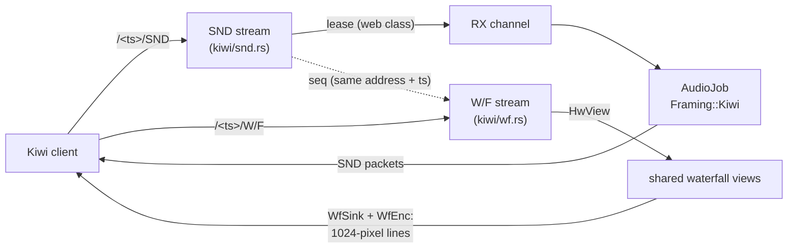

# M5 Kiwi protocol

Status: done 2026-11-11 (`crates/web/src/kiwi/`, feature `kiwi`, on by
default). kiwirecorder works (§6: kiwiclient 4eb733e against the sim and
against the Web-888 with real signals), and SuperSDR works against the
unit (tried by the project's owner). The end-to-end tests
(`crates/web/tests/kiwi.rs`) use a client that sends what kiwirecorder
sends. Left: a measured dBm calibration (§6).

## 1. What it is

The KiwiSDR WebSocket protocol, so Kiwi clients can use web888d:
kiwirecorder and the rest of kiwiclient, wsprdaemon (through kiwirecorder),
SuperSDR, and listing tools that read `/status`. web888d serves only the
protocol. Kiwi's browser UI isn't served; web888d's own UI stays at `/`.



Provenance: the behaviour is ported from the upstream server (KiwiSDR-derived,
RaspSDR/server at 4dfecc4, `rx/rx_server.cpp`, `rx/rx_cmd.cpp`,
`rx/rx_sound.cpp`, `rx/rx_sound_cmd.cpp`, `rx/rx_waterfall.cpp`,
`rx/rx_server_ajax.cpp`; LGPL-2.0-or-later, Copyright (c) 2014-2023 John
Seamons, ZL4VO/KF6VO). The receiving side was checked against kiwiclient's
`kiwi/client.py` (jks-prv/kiwiclient master, read, not run). The code is
written for web888d's sessions, leases and DSP. One exception: the IMA
ADPCM coder (`kiwi/adpcm.rs`) is written from the IMA algorithm. Upstream's
file (`rx/csdr/ima_adpcm.cpp`) carries Tim Kientzle's licence with an
advertising clause, which is not GPL-compatible.

## 2. The wire (`kiwi/wire.rs`)

* **Server to client** frames are binary, with a 3-letter tag:
  * `MSG name=value ...`: values URL-encoded where they can hold spaces
    (`load_cfg`).
  * `SND`: flags, sequence (LE u32), S-meter (BE u16, (dBm + 127) × 10),
    then audio.
  * `W/F `: first bin, zoom | flags, sequence (LE u32 each), then 1024
    level bytes.
* **Client to server**: `SET ...` text commands. web888d parses the ones in
  the table below. Like upstream, it accepts and ignores the rest
  (`genattn`, `gen`, `squelch`, `de_emp`, `interp`, `maxdb`, `MARKER`,
  ...). Before `SET auth`, only `SET keepalive` and `SET options` are
  allowed; anything else ends the stream.
* **S-meter bias:** 127, as in KiwiSDR and kiwiclient. The Web-888 fork
  moved it to 140, so kiwiclient reads that fork 13 dB high.

| command | SND | W/F |
|---|---|---|
| `auth t=kiwi\|admin p=` | listener / admin password | same |
| `mod= low_cut= high_cut= freq=` | mode, passband, dial (kHz) | |
| `agc= hang= thresh= slope= decay= manGain=` | AGC on/off, speed from `decay` (≤300 ms fast, ≤1.5 s medium, else slow), fixed gain = `manGain` dB | |
| `compression=` | ADPCM on/off | |
| `little-endian`, `reinit`, `AR OK`, `nb ...`, `ident_user=`, `keepalive` | as upstream | `keepalive` |
| `zoom= cf=` / `zoom= start=` | | the view |
| `wf_speed=0..4` (-1: fastest), `wf_comp=` | | 0, 1, 5, 13, 23 fps; ADPCM |

## 3. The audio stream (`kiwi/snd.rs`)

1. **Auth.** No listener password: any password (or `#`) gets in. With one,
   the password is checked as for a web login: argon2, one check at a
   time, failures limited per address. `t=admin` with the admin password
   gets the admin class (not limited, can't be pre-empted). Refusals send
   `badp=1`, `badp=4` (no admin password set) or `badp=5` (the per-address
   limit, or the same stream twice), then close.
2. **Channel.** A lease of class *web* (admin: *admin*): a Kiwi stream is
   a listener, as kiwirecorder is a user on a Kiwi. It isn't under the
   protocol class's quota (`[limits] hpsdr_channels`), and skimmers yield
   to it as to web users. Kiwi clients don't queue: with no channel free
   they get `too_busy=<n>` and the stream closes (kiwirecorder retries
   every 15 s), and the same happens if a higher class takes the channel
   later.
3. **Setup messages** in upstream's order: `rx_chans`, `badp=0`, `is_local`,
   version, `load_cfg` (with `rx_gps` from `[station] locator`, which
   kiwiclient needs), `freq_offset`, `center_freq bandwidth adc_clk_nom`,
   `audio_init audio_rate sample_rate`. `sample_rate` is 12 kS/s corrected
   by the PPS clock estimate.
4. **Audio** flows once the client has sent `mod`, `agc` and `AR OK` (the
   upstream rule). The job is the web sessions' `AudioJob` with
   `Framing::Kiwi`. A packet is 512 PCM16 samples (big-endian, or
   little-endian after `SET little-endian`), 2048 ADPCM samples in 1024
   bytes, or 512 I/Q pairs after a 10-byte GPS header (zeros: no
   timestamps yet).

**Modes.**

| Kiwi | web888d |
|---|---|
| usb, usn | USB |
| lsb, lsn | LSB |
| cw, cwn | USB with the client's passband (Kiwi's CW is USB around +500 Hz) |
| am, amn, amw | AM |
| sam, sal, sau, sas | SAM, SAL, SAR, SAS |
| iq, drm | IQ (new `Mode::Iq` in `dsp::audio`: the filtered channel, AGC on its magnitude) |
| nbfm, nnfm, anything else | AM (as upstream falls back) |

**Frequencies.** Kiwi's baseband starts at 0 Hz and is `bandwidth` wide.
web888d's range starts at `rf_lo`, which clients get as `freq_offset`, as
for a converter. On the Web-888 that offset is 0 and the bandwidth is
61.44 MHz. On the iq backend (a HackRF), the offset is its range's low
edge.

**Levels.** web888d measures dBFS. Kiwi clients get dBm =
dBFS + `[kiwi] smeter_offset_db` (default 0, uncalibrated), for the
S-meter and the waterfall alike.

**Limits.** The per-address session limit (`[limits] per_ip`, 4 by
default: a host running many recorders, as wsprdaemon does, belongs in
`[limits] trusted`) and the session time limit apply. The idle limit doesn't: a recorder never tunes. A stream with no
message for 60 s is closed (20 s before auth). Kiwi streams show in the
users list (name from `ident_user`) and the admin's session list, where
they can be kicked.

## 4. The waterfall stream (`kiwi/wf.rs`)

* **Pairing.** A W/F stream from the same address with the same URL
  timestamp as an open SND stream belongs to that session. It isn't
  counted against the address limit, and its lines carry the audio's
  sequence. On its own (kiwirecorder `--wf`), it is a session without an
  RX channel, and its lines count themselves.
* **The view.** Zoom z spans bandwidth / 2^z (z = 0..14). `start` counts
  in the deepest zoom's pixels. A view needs a zoom and a speed before it
  starts, as upstream. It becomes a shared hardware view: the narrowest
  span the hardware has that covers it, with enough bins for 1024 pixels.
* **Lines.** `WfEnc` resamples each line to 1024 pixels: each pixel is the
  strongest bin in it, or the nearest bin where bins are wider than
  pixels. Levels map 0..-200 dBm to bytes 255..55, as upstream. Compressed
  lines are 10 pad samples plus 1024, ADPCM from a fresh state each line.

## 5. Configuration

```toml
[kiwi]
enabled = true          # the streams, /status and /VER (applies at once)
name = ""               # shown by clients; empty: "web888d <callsign>"
location = ""
smeter_offset_db = 0.0  # dBm = dBFS + this
```

The position in `load_cfg` and `/status` comes from `[station] locator`.

## 6. kiwirecorder on web888d (2026-11-11)

kiwiclient at 4eb733e (jks-prv/kiwiclient), run locally against web888d
on the sim backend (a -40 dBFS tone at 7075.5 kHz):

| run | result |
|---|---|
| `-f 7074 -m usb --ncomp`, 10 s | 12 kS/s mono WAV, 10.07 s, tone at 1500 Hz; RSSI -40.0; version 1.902 and the GNSS position read from `load_cfg` |
| `-m usb` (ADPCM, the default) | tone at 1500 Hz, clean |
| `-m iq` | stereo WAV, tone at +1500 Hz, image -117 dB |
| `-f 7075 -m cw` | tone at 500 Hz |
| `-m am` on the bare carrier | silence (the AGC follows the carrier) |
| `-m lsb -g 40`, `--nb` | fixed gain 40 dB: full scale; NB: tone kept |
| `--wf -z 10`, `--wf -z 4 --wf-comp`, `--wf-png` | the tone in the middle of both PNGs |
| 13 recorders on 12 channels | 12 record, the 13th gets "too busy" and retries every 15 s |
| listener password: none, wrong, `--pw` right | bad-password error, the same, records |

Found on the way:

* At first only 7 got channels: the protocol class has HPSDR's quota
  (`hpsdr_channels`). Kiwi streams are now of class web (§3).
* `per_ip` (4) stops the fifth recorder from one host with `badp=5`
  ("No multiple connections from the same IP address").
* kiwiclient drops the 10 ADPCM pad samples from the end of a compressed
  waterfall line, while the Kiwi browser UI (and the encoder, upstream's
  and ours) puts them at the start. Its compressed waterfalls are
  therefore 10 pixels off on any Kiwi; uncompressed ones are fine.

### On the Web-888 with real signals (2026-11-11)

The project's unit (channelizer bitstream, 32 channels, FT8 skimmers on
ten bands, a 160 m OCFD), server 2f72451, kiwirecorder through an SSH
relay:

| run | result |
|---|---|
| 40 m FT8, `-m usb -L 200 -H 3000`, 47 s, ADPCM and PCM at once | decoded with `ft8wav`: 11 and 13 messages in the two whole slots, the same from both; the unit's own 40 m skimmer had 11 and 10 in the same slots, the strong ones identical |
| 20 m `-m iq` | stereo, the FT8 band at +0.2..+3 kHz |
| 6070 kHz `-m am` | audio, AGC on the carrier |
| `--wf -z 5 --wf-auto` around 7.1 MHz | the band as in the web UI; `-z 0` with kiwirecorder's fixed -155..-30 dB scale is all hot (uncalibrated levels, below) |
| `--S-meter=20` | 7150 kHz USB -94.7, 7074 kHz -94.0, 6070 kHz AM -91.0, 26 MHz -103.9: dBFS, since `smeter_offset_db` = 0 |

**Levels.** A Kiwi's waterfall, like ours, is power in the bin (a sine
reads the same at any zoom; the noise floor rises with the bin width), so
only the dBm offset differs. It needs a measurement with a known signal
(a generator through a known attenuator); until then Kiwi clients see dBFS.
Daytime 40 m noise of about -95 dBFS in 2.4 kHz suggests an offset of
roughly -10 to -15 dB. The unit runs with `smeter_offset_db = -12.0` as
a provisional value (7150 kHz then reads -107 dBm) until a measurement
replaces it.

`/status` counted the skimmers' leases as users (`users=10` on an idle
receiver); it counts people now.

## 7. Not done

* Camping (`?camp`): answered with `camp_disconnect`.
* The `EXT` stream (extensions), Kiwi's admin and DX-label commands, and
  the browser UI.
* GPS timestamps in IQ packets (wait for M6's timestamps), TDoA.
* NBFM, de-emphasis, the Kiwi squelch, and the noise reduction algorithms
  by number.
* A measured dBm calibration (`smeter_offset_db`; -12 dB provisional on
  the unit).
