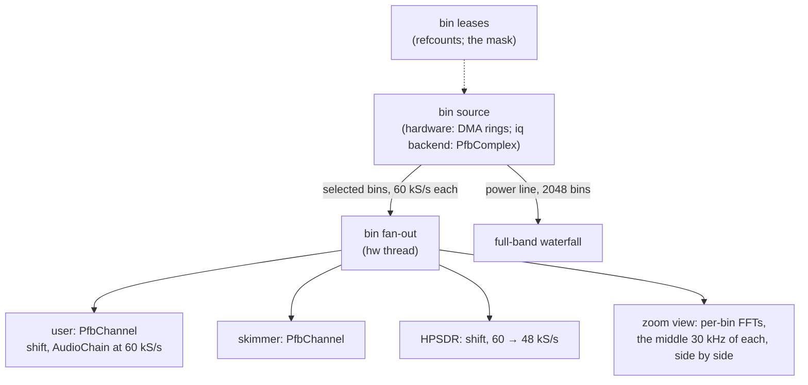

# M6 channelizer: server side

Status: **steps 1-6 done** (2026-10-29): web888d serves the web UI,
the skimmers and HPSDR from the bins, and draws the waterfall from them,
on the iq backend and on the unit's channelizer bitstream. The bitstream
side is `hw/docs/channelizer.md` in web888-ng-hw. Open: §6.

Done when:

* web888d on the iq backend in bins mode serves the web UI, HPSDR and the
  skimmers from bins, with the same audio quality as today (the float
  model's comparison, `hw/docs/channelizer.md` §3.1, §3.3).
* More users than RX channels today: the limit is CPU, the 64 bins a
  frame the hardware sends, and two users in one bin cost one bin.
* The waterfall needs no WF slots: the full band from the power line,
  zoomed views from the bins they cover.

---

## 1. Picture

## 2. The bin source

The hardware and the iq backend both give, per 60 kS/s frame, the
selected bins in ascending order, and, every N frames, the power of all
bins (`hw/docs/channelizer.md` §3.7). One trait, in `web888-radio`:

* `caps()`: bin spacing (30 kHz), frame rate (60 kHz), bin count, the
  frequency of bin 0, the most bins a frame (64).
* `set_bins(&[usize]) -> gen`: the selection, taking effect at a frame
  boundary; frames carry the gen they used.
* `read(&mut frames)`: the frames since the last call (gen, frame count,
  `Iq32` per selected bin, scaled like RX samples: a full-scale sine
  reads `RX_SINE_FULL_SCALE`).
* `set_power(frames_per_line)`, `read_power(&mut line) -> Option<u32>`:
  a power line (f32 per bin, |X|² summed), its line number.

The iq backend's bank: `PfbComplex` with M = rate / 30 kHz (256 at 7.68
MS/s), so bins are 30 kHz apart at 60 kS/s as on the hardware; bin k is
`center + k·30 kHz` (k ≥ M/2: below the centre). Its power line covers
the input's band instead of 0–61 MHz.

## 3. Users, skimmers, HPSDR on bins

**First step taken (2026-10-29): bins behind the `Radio` trait.**
`web888_dsp::binrx::BinRx` wraps any `BinRadio` as a radio with N
*virtual* RX channels (`[radio] bins = N`, `--bins N`; automatic with the
channelizer bitstream, 32 then). A tuned channel takes the bin its
frequency falls in (refcounted: the selection is the bins in use), is
shifted from the bin centre to 0 Hz and resampled from 60 kS/s to the RX
rate (8/r2: 4/5 at r2 10, polyphase, 70 dB, one phase schedule for all
channels so RX frames stay whole). The hw thread, the lease manager, the
web sessions, the skimmers and HPSDR run unchanged; the channel count is
a setting, not the bitstream's. Against an RX channel on the same
recording (`crates/iq/examples/binscompare.rs`): coherence 1.00000, the
residual −74.5 dB within ±3 kHz (−66 dB within ±12 kHz), the level
within 0.15 dB.

**At 60 kS/s (2026-10-29).** web888d runs bins mode with the RX rate
equal to the bins' frame rate (r2 8: 60 kS/s), where `BinRx` passes the
shifted bin through without a resampler: the plan below, the
`AudioChain` straight at 60 kS/s, decimating by 5. HPSDR resamples its
receivers to 48 kS/s (`web888_dsp::resample`, 4/5, the same polyphase
filter). The chain's decimator is now sized for the passband (edge +
300 Hz in 500 Hz steps: SSB and CW a quarter of the taps; AM as
before), and bins mode corrects no CIC droop (there is none). On the
A9, a USB listener costs 3.2 % of a core instead of 5.4 % (`BinRx` 0.98
% per channel, marginal, instead of 2.35 %; the chain 2.2 % at 60 kS/s
instead of 3.0 % at 48), and stock mode's USB chain halves (1.5 %).

* **Leases**: a receiver is a dial and a passband; it needs the bin its
  passband sits in (the nearest centre: the channel is within ±15 kHz of
  it, flat to ±21 kHz). Bins are refcounted; the selection is the bins
  with a count. The 64-bin limit replaces the RX channel count; the
  queue and listen-along stay as they are (`m3-multi-user.md` §2.3).
* **Per user**: `PfbChannel` (shift by the offset from the bin centre,
  `AudioChain` at 60 kS/s, decimating by 5). On the DSP pool, as today.
* **HPSDR**: its receivers want 48 kS/s: shift, then a 4/5 resampler
  (polyphase, 80 dB).
* **Skimmers**: an FT8 band is 3 kHz: one bin, shared with any user in
  it.

## 4. Waterfall

* **Full band**: the power line, 2048 bins of 30 kHz (iq backend: its
  band), any line rate. Views wider than 64 bins (1.92 MHz) use it,
  resampled to the view's pixels.
* **Zoomed views** (up to 64 bins): each bin's stream through an FFT,
  the middle 30 kHz of each (the bins overlap 2×, so the middles tile
  the band), side by side. The view's bins are leased like a user's,
  at a lower priority (a view gives its bins up to receivers; it then
  falls back to the power line).
* The WF scheduler's slots and time-sharing go away for this backend;
  the stock-driver backend keeps them.

**Done (2026-10-29)** as above: `crates/web/src/binview.rs`
(`BinViewJob`, one per shared view, on the DSP pool) through `BinRx`'s
tap (`BinTap`: frames and power lines handed to other threads by
`Arc`, no copy and no FFT on the hw thread). Zoom up to 33 bins (960
kHz); a view's bins are selected after the RX channels' as far as the
frame has room, and a bin left out shows the power line's level. Each
bin's FFT is sized so its bins are no wider than the display's, and its
budget is the view's (the sum of the per-bin FFT lengths equals one
full view's FFT). In bins mode even views inside a session's channel
come from the bins: the channel is clean only within ±21 kHz of its
bin's centre. Checked in headless Chromium on the iq backend: spans
3.84 MHz to 15 kHz, no seam at the bin edges; unit tests: a tone on a
bin edge at its level once, a missing bin at the power line's level, the
power line averaged.

**Dragging and wide views (2026-10-29).** A view whose only session
drags or zooms it moves with the session instead of starting over: it
keeps the FFTs of the bins it still covers and runs one bin more on
each side (`TAP_BINS` 19), so a bin coming into view has its spectrum
at hand; while bins new to it fill, it holds its lines (at most 250 ms)
rather than draw the power line's flat level there. The UI's spectrum
average follows a moved view instead of restarting. Wide views (more
than 17 bins: 960 kHz and up) still have only the power line's 30 kHz:
the UI draws bins wider than 3 pixels interpolated between their
centres (spectrum and waterfall shader) instead of as blocks. That is
smoother, not finer; finer needs more bins read (a 960 kHz zoom: 35, about
18 % more of a core) or bins read in turns.

## 5. Steps (each ends in a commit)

| # | content | done when |
|---|---|---|
| 1 | the bin-source trait; the iq backend's bank behind it | unit tests: a tone in the right bin at the right level, selection switching by gen, the power line equal to the bins' summed power |
| 2 | the iq backend in bins mode (`--backend iq --bins`): the hw thread reads frames and fans them out | a bench: frames per second, CPU, on a recording. **Bank side done**: `IqConfig::bins`, `BinRadio for IqRadio`; `examples/binsbench`: 4.0x real time at 7.68 MS/s on the workstation (0 bins), 3.2x with 64 selected and power lines (one core; the bank's branch sums dominate) |
| 3 | bin leases; users and skimmers on `PfbChannel` | the M3 load test (13 sessions) on bins; skimmer decodes on a recording as many as on RX channels. **First form done** (§3: `BinRx`, virtual RX channels from bins; the bins channel equals the RX channel to −74.5 dB within ±3 kHz). Load test on the workstation (iq backend, `bins = 32`, the 60 s recording looped): **24 sessions, each its own receiver** (dials 25 kHz apart over 21 bins, mixed views): 12 012 S/s audio each, no gaps or drops, waterfalls 20 lines/s; 66 % of a core with the software bank. **On the unit** (2026-10-29, the channelizer bitstream, `bins = 16`): RX 47 976 frames/s (48 000 due); FT8 on bins 211 spots in the first 4 slots (40 m + 20 m, as the RX-channel receiver that morning); 14 web sessions + the 2 skimmers on all 16 channels: 12 000 S/s each, no gaps or drops, no FT8 slot dropped (416 spots in 8), both cores busy. `BinRx` cost 3.1 % of an A9 core per tuned channel (`examples/binrxbench`), so 16 channels was the hw thread's practical limit; since §3's 60 kS/s path, 0.98 % (marginal), and a USB listener 3.2 % in all instead of 5.4 %. (A first run lost 15 % of the frames: idle channels were filtered too; fixed.) |
| 4 | waterfall from the power line and per-bin zoom | browser check; zoomed view seamless across bin edges. **Done** (§4): spans 3.84 MHz to 15 kHz in headless Chromium, no seams; webload 14 sessions (mixed views; and 14 distinct 480 kHz zooms): audio 12 000 S/s each, no gaps, 20 fresh lines/s |
| 5 | HPSDR at 48 kS/s from bins | `p1probe` against the server. **Done**: 48 kS/s, no sequence gaps, the in-band tones as on RX channels (within 0.2 dB); since the 60 kS/s change, resampled in the HPSDR server (test `two_receivers_from_60k_blocks`: tones within 0.02 dB). The band edges differ: §6 |
| 6 | the channelizer bitstream's driver (`/dev/mem` + a reserved DMA window, or a small kernel module) | on the test unit (`hw/docs/channelizer.md` §5). **Driver side done** (2026-10-29): the open `web888-sdr` driver's `ZSDR_PFB_*` ioctls (the units now run it under web888-ng-os, so the driver allocates the rings itself), `BinRadio` for `ZynqsdrRadio` with the channelizer signature (`crates/zynqsdr/src/pfb.rs`: the ring parsers; tests against a fake driver). Not yet on hardware |

## 6. Open

* **HPSDR's 48 kHz from one bin**: the bin is flat to ±21 kHz around
  its centre and the dial may be 15 kHz off it, so of the 48 kHz a
  receiver sends, only what is within both ±18 kHz of the dial and ±21
  kHz of the bin's centre is clean; the rest of one edge is folded
  (p1probe on the recording: components at ±21-23 kHz up to 14 dB
  above the RX channel's). Decoding and listening are unaffected; a
  panadapter shows it. A clean 48 kHz would take the two or three bins
  the window covers, crossed over (2-3x the per-channel work).
* **The frames' cost per frame**: a `BinFrame` (and a `Vec`) per 60 kHz
  frame on the hw thread; binrxbench's fixed part is ~11-14 % of an A9
  core. A block of frames in one allocation would save most of it.
* **The unit at `bins = 32` (2026-10-29, 6f1082b): no capacity gain
  yet.** Idle it works (RX 60k frames/s, FT8 as before, full-band
  waterfall 0-61 MHz from the power line, zooms seamless), but under
  load it holds fewer sessions than the 10:11 run (r2 10, no
  waterfall): 14 mixed-view sessions already starve the hw thread (RX
  25-52k frames/s); 14 on one shared full view are clean at 0 % idle.
  Per thread at 14 mixed: hw thread 63 % (30 % idle with 32 channels
  configured), pool 108 %, web 20 %, 19 % system time. The causes, in
  likely order: the zoom views' bins fill the selection to 64 (the
  driver's PFB_READ copy alone was 31 % of a core at 64 bins), the
  per-frame `BinFrame` allocation and parse, the RX blocks carrying all
  32 channels at 60 kS/s, and the zooms' FFTs on the pool.
  **Then (5f36186):** frames in runs (`BinFrames`, one allocation per
  run) and the ring parsed in place: the parser on the A9 25 % -> 10 %
  of a core at 16 bins, 66 % -> 37 % at 64 (`zynqsdr/examples/pfbbench`);
  views' bins capped at 17 in total. RX blocks' width hardly matters (16
  jobs: 5.9 % of 32 channels, 5.5 % of 16), left as is. On the unit: hw
  thread idle 21 % (30), **10 mixed-view sessions + 2 skimmers clean**,
  14 nearly (11 200 S/s of 12 000; RX 54-57k frames/s). The A9's two
  cores are full there: hw thread 65 %, pool 81 %, web 23 %, FT8 decode
  38 %. More users in bins mode need work off the CPU: the per-user
  fine tuner in the FPGA (bin, shift, decimate to 12 kS/s for up to 64
  users: 1-2 DSP48, ~2 BRAM36; removes `BinRx` and the chain's
  decimator, and most of the bins read), then zoom spectra in the FPGA.
* **The bins tuner (2026-10-29): done, on the unit.** The FPGA's
  `pfb_tune` (`hw/docs/channelizer.md` §3.8) turns and decimates 32
  users' bins to 12 kS/s and hands them to the stock RX ring; web888d
  takes its users as the RX channels (`BinRx::tap_only`: the bins only
  for the waterfall). On the unit: the hw thread 12 % idle (21 % with the
  bins on the CPU); **20 mixed-view sessions + 2 FT8 skimmers clean**
  (10 before), 30 on one shared view clean, 30 mixed nearly (the cores
  full: the pool's audio and waterfalls, 93 %, and the web threads, 43
  %). Next limits: the waterfall's FFTs (the zooms) and the web tasks.
  Measured on the A9 at 12 kS/s (`examples/bench`, `R2=40`): a zoom view
  (17 bins, 128-point FFTs at 20 fps) 0.74 % of a core, a USB chain 1.35
  % (3.4 % with NB, NR and squelch). Zoom spectra in the FPGA would save
  at most ~22 % of one core at 30 zoomed sessions, and the device has no
  room left for them (LUT 87.5 %, BRAM 56.5/60): not pursued. The web
  threads (43 % at 30 sessions) are the larger share. HPSDR from the tuner
  is 12 kS/s resampled to 48 (±6 kHz of content). The bitstream run met
  timing only against the real clock (+0.22 ns); since hw c9401b0 it
  meets the build's 0.4 ns guardband too (WNS +0.058 ns, as the stock
  HF build), not yet run on the unit.

* The 64-bin limit against zoomed views: a 1.92 MHz view takes all 64.
  Views may need a cap (say 16 bins: 480 kHz) or to use the power line
  sooner.
* The driver for step 6: settled by running our own OS and driver (the
  stock module's buffers couldn't serve another layout).
