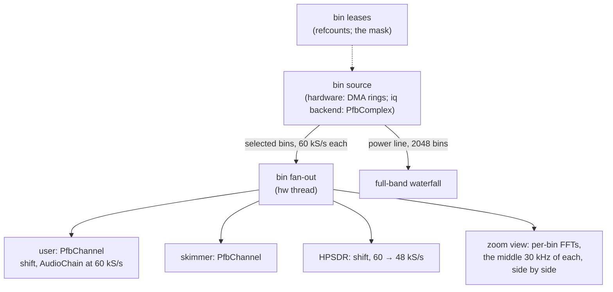

# M6 channelizer: server side

Status: **step 1 done, step 2 half** (2026-10-29: the iq backend runs the
bank behind `BinRadio`; the hw thread's fan-out is next). The bitstream side is
`hw/docs/channelizer.md` in web888-ng-hw (datapath and outputs
bit-exact in simulation, timing met). Scope: the server running on
**bins** instead of tuned RX channels and waterfall slots, first against
the iq backend, then the channelizer bitstream.

Done when:

* web888d on the iq backend in bins mode serves the web UI, HPSDR and the
  skimmers from bins, with the same audio quality as today (the float
  model's comparison, `hw/docs/channelizer.md` §3.1, §3.3).
* More users than RX channels today: the limit is CPU, the 64 bins a
  frame the hardware sends, and two users in one bin cost one bin.
* The waterfall needs no WF slots: the full band from the power line,
  zoomed views from the bins they cover.

---

## 1. Picture

## 2. The bin source

The hardware and the iq backend both give, per 60 kS/s frame, the
selected bins in ascending order, and, every N frames, the power of all
bins (`hw/docs/channelizer.md` §3.7). One trait, in `web888-radio`:

* `caps()`: bin spacing (30 kHz), frame rate (60 kHz), bin count, the
  frequency of bin 0, the most bins a frame (64).
* `set_bins(&[usize]) -> gen`: the selection, taking effect at a frame
  boundary; frames carry the gen they used.
* `read(&mut frames)`: the frames since the last call (gen, frame count,
  `Iq32` per selected bin, scaled like RX samples: a full-scale sine
  reads `RX_SINE_FULL_SCALE`).
* `set_power(frames_per_line)`, `read_power(&mut line) -> Option<u32>`:
  a power line (f32 per bin, |X|² summed), its line number.

The iq backend's bank: `PfbComplex` with M = rate / 30 kHz (256 at 7.68
MS/s), so bins are 30 kHz apart at 60 kS/s as on the hardware; bin k is
`center + k·30 kHz` (k ≥ M/2: below the centre). Its power line covers
the input's band instead of 0–61 MHz.

## 3. Users, skimmers, HPSDR on bins

**First step taken (2026-10-29): bins behind the `Radio` trait.**
`web888_dsp::binrx::BinRx` wraps any `BinRadio` as a radio with N
*virtual* RX channels (`[radio] bins = N`, `--bins N`; automatic with the
channelizer bitstream, 32 then). A tuned channel takes the bin its
frequency falls in (refcounted: the selection is the bins in use), is
shifted from the bin centre to 0 Hz and resampled from 60 kS/s to the RX
rate (8/r2: 4/5 at r2 10, polyphase, 70 dB, one phase schedule for all
channels so RX frames stay whole). The hw thread, the lease manager, the
web sessions, the skimmers and HPSDR run unchanged; the channel count is
a setting, not the bitstream's. Against an RX channel on the same
recording (`crates/iq/examples/binscompare.rs`): coherence 1.00000, the
residual −74.5 dB within ±3 kHz (−66 dB within ±12 kHz), the level
within 0.15 dB. The plan below (each user's `AudioChain` straight at
60 kS/s, no resampler) remains the way to save the resampler's CPU.

* **Leases**: a receiver is a dial and a passband; it needs the bin its
  passband sits in (the nearest centre: the channel is within ±15 kHz of
  it, flat to ±21 kHz). Bins are refcounted; the selection is the bins
  with a count. The 64-bin limit replaces the RX channel count; the
  queue and listen-along stay as they are (`m3-multi-user.md` §2.3).
* **Per user**: `PfbChannel` (shift by the offset from the bin centre,
  `AudioChain` at 60 kS/s, decimating by 5). On the DSP pool, as today.
* **HPSDR**: its receivers want 48 kS/s: shift, then a 4/5 resampler
  (polyphase, 80 dB).
* **Skimmers**: an FT8 band is 3 kHz: one bin, shared with any user in
  it.

## 4. Waterfall

* **Full band**: the power line, 2048 bins of 30 kHz (iq backend: its
  band), any line rate. Views wider than 64 bins (1.92 MHz) use it,
  resampled to the view's pixels.
* **Zoomed views** (up to 64 bins): each bin's stream through an FFT,
  the middle 30 kHz of each (the bins overlap 2×, so the middles tile
  the band), side by side. The view's bins are leased like a user's,
  at a lower priority (a view gives its bins up to receivers; it then
  falls back to the power line).
* The WF scheduler's slots and time-sharing go away for this backend;
  the stock-driver backend keeps them.

## 5. Steps (each ends in a commit)

| # | content | done when |
|---|---|---|
| 1 | the bin-source trait; the iq backend's bank behind it | unit tests: a tone in the right bin at the right level, selection switching by gen, the power line equal to the bins' summed power |
| 2 | the iq backend in bins mode (`--backend iq --bins`): the hw thread reads frames and fans them out | a bench: frames per second, CPU, on a recording. **Bank side done**: `IqConfig::bins`, `BinRadio for IqRadio`; `examples/binsbench`: 4.0x real time at 7.68 MS/s on the workstation (0 bins), 3.2x with 64 selected and power lines (one core; the bank's branch sums dominate) |
| 3 | bin leases; users and skimmers on `PfbChannel` | the M3 load test (13 sessions) on bins; skimmer decodes on a recording as many as on RX channels. **First form done** (§3: `BinRx`, virtual RX channels from bins; the bins channel equals the RX channel to −74.5 dB within ±3 kHz). Load test on the workstation (iq backend, `bins = 32`, the 60 s recording looped): **24 sessions, each its own receiver** (dials 25 kHz apart over 21 bins, mixed views): 12 012 S/s audio each, no gaps or drops, waterfalls 20 lines/s; 66 % of a core with the software bank. On the unit next |
| 4 | waterfall from the power line and per-bin zoom | browser check; zoomed view seamless across bin edges |
| 5 | HPSDR at 48 kS/s from bins | `p1probe` against the server |
| 6 | the channelizer bitstream's driver (`/dev/mem` + a reserved DMA window, or a small kernel module) | on the test unit (`hw/docs/channelizer.md` §5). **Driver side done** (2026-10-29): the open `web888-sdr` driver's `ZSDR_PFB_*` ioctls (the units now run it under web888-ng-os, so the driver allocates the rings itself), `BinRadio` for `ZynqsdrRadio` with the channelizer signature (`crates/zynqsdr/src/pfb.rs`: the ring parsers; tests against a fake driver). Not yet on hardware |

## 6. Open

* The 64-bin limit against zoomed views: a 1.92 MHz view takes all 64.
  Views may need a cap (say 16 bins: 480 kHz) or to use the power line
  sooner.
* The driver for step 6: settled by running our own OS and driver (the
  stock module's buffers couldn't serve another layout).
